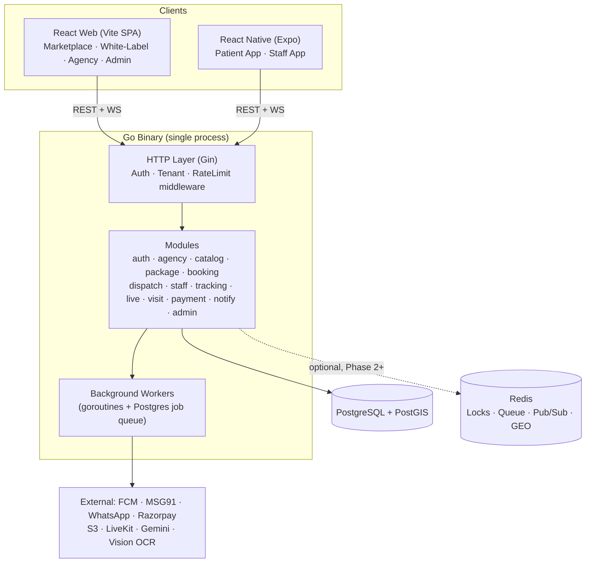
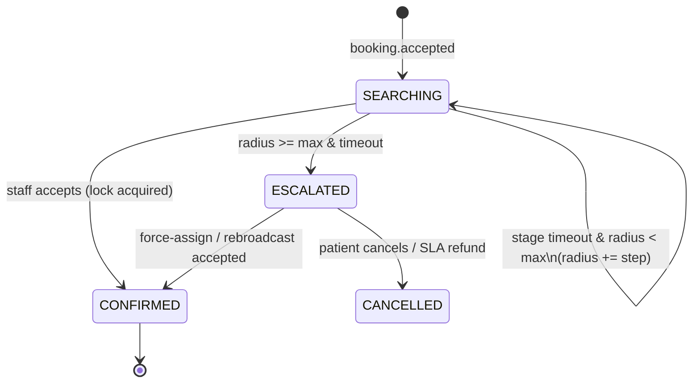

# 🛠️ Nurture Care — Implementation Design Document

> **Version:** 1.2  
> **Date:** October 25, 2026  
> **Based on:** requirement.md v2.4  
> **Stack:** Go (backend) · React + Vite (web) · React Native + Expo (mobile) · SQLite / PostgreSQL + PostGIS · *(Redis optional — Phase 2+, behind interfaces)*  
> **Principles:** Simple · Modular · Extendable · Minimal infra (single 2 GB VPS)

---

## 1. Architecture Overview

**Modular monolith** — one Go binary, internally split into independent modules. Each module can later be extracted into a microservice without rewrites.



### Key Decisions
| Decision | Choice | Reason |
|---|---|---|
| Backend style | Modular monolith | Single binary, low RAM, easy to split later |
| HTTP framework | **Gin** | Most popular, simple, huge ecosystem |
| DB access | **pgx + sqlc** | Type-safe SQL generated into Go; no heavy ORM |
| Migrations | **goose** | Plain SQL migration files |
| Background jobs | **Postgres `jobs` table** (`FOR UPDATE SKIP LOCKED`) + goroutine workers | No extra broker; Redis Streams adapter later |
| Locks / Pub-Sub / Timers | **Postgres advisory locks + in-memory Go** (Phase 1) | Zero extra infra; swap to Redis via config |
| Infra abstraction | `Locker`, `Queue`, `Bus`, `GeoIndex`, `Scheduler` interfaces | Switch Postgres/memory → Redis without touching modules |
| Live video | **LiveKit** (self-host or cloud) | WebRTC SFU with recording, Go & React SDKs |
| Monorepo | **pnpm workspaces + Turborepo** | Share TS types/API/logic between web & app |
| Web state | **TanStack Query + Zustand** | Same on web & mobile |
| Styling | Tailwind (web) + NativeWind (app) | Same class names across platforms |
| Validation | **Zod** (frontend) · `go-playground/validator` (backend) | |

---

## 2. Repository Structure

```
nurture-care/
├── requirement.md
├── implementation.md
├── backend/                      # Go
│   ├── cmd/
│   │   ├── api/main.go           # HTTP server + workers (default single process)
│   │   └── worker/main.go        # Optional: workers only (when scaling)
│   ├── internal/
│   │   ├── platform/             # Cross-cutting infrastructure
│   │   ├── modules/              # Business modules (one folder each)
│   │   └── workers/              # Background job consumers
│   ├── migrations/               # goose SQL files
│   ├── queries/                  # sqlc .sql files
│   ├── sqlc.yaml
│   ├── Makefile
│   └── Dockerfile
├── apps/
│   ├── web/                      # React + Vite (all web portals)
│   └── mobile/                   # React Native + Expo (patient + staff)
├── packages/
│   ├── types/                    # Shared TS types & DTOs
│   ├── api-client/               # Shared fetch client + TanStack Query hooks
│   ├── core/                     # Shared business logic (pricing, validation, formatting)
│   ├── realtime/                 # Shared WebSocket client + event types
│   └── config/                   # Shared eslint, tsconfig, tailwind preset
├── deploy/
│   ├── docker-compose.yml        # postgres, redis, api, caddy, livekit
│   └── Caddyfile
├── pnpm-workspace.yaml
└── turbo.json
```

---

## 3. Backend Design (Go)

### 3.1 Standard Module Layout

Every module follows the **same 5-file pattern** — easy for humans and AI to extend:

```
internal/modules/<module>/
├── model.go        # Domain structs + enums
├── dto.go          # Request/response structs with validation tags
├── repository.go   # DB access (wraps sqlc queries)
├── service.go      # Business logic (interface + implementation)
└── handler.go      # Gin HTTP handlers + RegisterRoutes()
```

```go
// Pattern every module follows
type Service interface {
    Create(ctx context.Context, in CreateInput) (*Booking, error)
}
type service struct { repo Repository; bus events.Bus }

type Handler struct { svc Service }
func (h *Handler) RegisterRoutes(r *gin.RouterGroup) { r.POST("/bookings", h.Create) }
```

**Adding a new module** = create folder with 5 files + register in `cmd/api/main.go`. Nothing else changes.

### 3.2 Platform Packages (`internal/platform/`)

| Package | File(s) | Responsibility |
|---|---|---|
| `config` | `config.go` | Load env vars into typed `Config` struct |
| `db` | `postgres.go`, `tx.go` | pgx pool, transaction helper `WithTx(ctx, fn)` |
| `lock` | `lock.go`, `pglock.go`, `redislock.go`* | `Locker` interface; Postgres advisory-lock impl (Phase 1) |
| `queue` | `queue.go`, `pgqueue.go`, `redisqueue.go`* | `Queue` interface; Postgres `jobs` table impl |
| `events` | `bus.go`, `membus.go`, `pgbus.go`, `redisbus.go`*, `events.go` | `Bus` interface; in-memory impl (single node), `LISTEN/NOTIFY` impl (multi-node) |
| `geo` | `geo.go`, `postgis.go`, `redisgeo.go`* | `GeoIndex` interface; PostGIS impl |
| `scheduler` | `scheduler.go`, `memscheduler.go`, `redisscheduler.go`* | `Scheduler` interface for dispatch stage timeouts; in-memory timers + DB recovery |
| `infra` | `factory.go` | Builds implementations from `INFRA_BACKEND=postgres\|redis` |
| `ws` | `hub.go`, `client.go` | WebSocket hub: rooms per user/booking/agency |
| `auth` | `jwt.go`, `password.go`, `otp.go` | JWT issue/verify, bcrypt, OTP generate/verify |
| `middleware` | `auth.go`, `tenant.go`, `rbac.go`, `ratelimit.go`, `logger.go`, `recover.go` | Request pipeline |
| `storage` | `s3.go` | Presigned upload/download URLs |
| `httpx` | `response.go`, `errors.go`, `pagination.go` | Standard JSON envelope & error mapping |
| `logger` | `logger.go` | `slog` structured logging |
| `clock` | `clock.go` | Mockable time (for dispatch timer tests) |

\* Redis adapters are Phase 2+ — added only when scaling to multiple API instances.

**Standard response envelope**
```json
{ "data": { }, "error": null, "meta": { "page": 1, "pageSize": 20, "total": 134 } }
```

### 3.3 Modules & Key Types

| # | Module | Key Models (`model.go`) | Key Service Methods (`service.go`) |
|---|---|---|---|
| 1 | **auth** | `User`, `Role`, `Session`, `OTP` | `RequestOTP`, `VerifyOTP`, `Login`, `Refresh`, `Logout` |
| 2 | **user** | `Patient`, `CareRecipient`, `Address`, `FamilyMember` | `GetProfile`, `UpdateProfile`, `AddRecipient`, `AddAddress`, `AddFamilyMember` |
| 3 | **agency** | `Agency`, `AgencyMode`, `Branding`, `Domain`, `DispatchConfig` | `Register`, `Approve`, `UpdateBranding`, `ResolveByDomain`, `UpdateDispatchConfig` |
| 4 | **catalog** | `Category`, `Service`, `AgencyService` | `ListCategories`, `ListServices`, `GetService`, `EnableForAgency`, `SetAgencyPrice` |
| 5 | **package** | `Package`, `PackageItem`, `PackageType` (predefined/custom), `Proposal` | `Create`, `Publish`, `CreateCustom`, `SendProposal`, `RespondProposal`, `ConvertToTemplate` |
| 6 | **pricing** | `Discount`, `DiscountType`, `PromoCode`, `PriceQuote` | `Quote(items, promo)`, `ValidatePromo`, `ApplyDiscounts` |
| 7 | **staff** | `Staff`, `Qualification`, `Document`, `Availability`, `AgencyMembership`, `OnlineStatus` | `Register`, `UploadDocument`, `Verify`, `SetAvailability`, `GoOnline`, `GoOffline`, `JoinAgency` |
| 8 | **booking** | `Booking`, `BookingStatus`, `Visit`, `Schedule` | `Create`, `Accept`, `Cancel`, `Reschedule`, `Get`, `List`, `Assign` |
| 9 | **dispatch** | `DispatchJob`, `DispatchStage`, `Offer`, `OfferStatus` | `Start(bookingID)`, `ExpandRadius`, `AcceptOffer`, `DeclineOffer`, `ForceAssign`, `Escalate` |
| 10 | **tracking** | `LocationPing`, `TripStatus` | `UpdateLocation`, `StartTrip`, `GetLiveLocation`, `CheckGeofence` |
| 11 | **live** | `LiveSession`, `Consent`, `Viewer`, `Recording` | `StartSession`, `IssueViewerToken`, `PauseVideo`, `EndSession`, `GetRecording` |
| 12 | **visit** | `CareNote`, `Vital`, `VitalSource` (ocr/manual), `AISummary`, `KeyMoment` | `CheckIn`, `AddNote`, `RecordVitals`, `CheckOut`, `GetSummary` |
| 13 | **payment** | `Payment`, `Invoice`, `Refund`, `Wallet`, `Payout` | `CreateOrder`, `HandleWebhook`, `Refund`, `GenerateInvoice`, `CalculatePayouts` |
| 14 | **review** | `Review` (staff/agency) | `Create`, `List`, `Reply` |
| 15 | **notify** | `Notification`, `Channel`, `Template`, `DeviceToken` | `Send`, `RegisterDevice`, `List`, `MarkRead` |
| 16 | **support** | `Ticket`, `TicketMessage` | `Create`, `Reply`, `Resolve` |
| 17 | **admin** | `AuditLog`, `PlatformSetting`, `Report` | `Dashboard`, `ListAgencies`, `SetCommission`, `Reports` |

### 3.4 Roles (RBAC)
`PATIENT` · `FAMILY` · `STAFF` · `AGENCY_ADMIN` · `AGENCY_CARE` (customer care) · `AGENCY_DISPATCHER` · `SUPER_ADMIN`

Tenant middleware resolves `agency_id` from: JWT claim → `X-Agency-Id` header → request `Host` (white-label domain).

### 3.5 Pluggable Infrastructure (Redis-Ready)

Modules depend **only on interfaces**, never on Postgres/Redis directly for these concerns:

```go
// platform/lock
type Locker interface {
    TryLock(ctx context.Context, key string, ttl time.Duration) (unlock func(), ok bool, err error)
}
// platform/queue
type Queue interface {
    Enqueue(ctx context.Context, topic string, payload any, opts ...Option) error // delay, dedupe key
    Consume(ctx context.Context, topic string, h func(ctx context.Context, job Job) error) error
}
// platform/events
type Bus interface {
    Publish(ctx context.Context, e Event) error
    Subscribe(topic string, h func(Event))
}
// platform/geo
type GeoIndex interface {
    UpdateStaff(ctx context.Context, staffID uuid.UUID, p Point) error
    Nearby(ctx context.Context, p Point, radiusM int, f Filter) ([]uuid.UUID, error)
}
// platform/scheduler
type Scheduler interface {
    At(ctx context.Context, key string, at time.Time, topic string, payload any) error
    Cancel(ctx context.Context, key string) error
}
```

| Interface | Phase 1 (no Redis) | Phase 2+ (Redis) |
|---|---|---|
| `Locker` | `pg_try_advisory_xact_lock(hash(key))` + `WHERE status='SEARCHING'` guard | `SET NX PX` / Redlock |
| `Queue` | `jobs` table, `SELECT … FOR UPDATE SKIP LOCKED`, retries + `run_at` | Redis Streams + consumer groups |
| `Bus` | In-memory Go channels (single node) → `LISTEN/NOTIFY` (multi-node) | Redis Pub/Sub |
| `GeoIndex` | PostGIS `ST_DWithin` on `staff.last_location` (GIST) | Redis `GEOSEARCH` |
| `Scheduler` | In-memory `time.AfterFunc` + `dispatch_jobs.stage_expires_at`; on boot, reload pending | Redis sorted set |

**Switching** = implement the Redis adapter, set `INFRA_BACKEND=redis`, add redis to docker-compose. No module code changes. Each interface has a shared contract test suite run against every implementation.

---

## 4. REST API Endpoints

Base: `/api/v1` · Auth: `Bearer JWT` · 🔓 = public

### 4.1 Auth
| Method | Path | Role | Purpose |
|---|---|---|---|
| POST | `/auth/otp/request` | 🔓 | Send OTP to mobile |
| POST | `/auth/otp/verify` | 🔓 | Verify OTP → access + refresh token |
| POST | `/auth/login` | 🔓 | Email/password (agency & admin) |
| POST | `/auth/refresh` | 🔓 | Refresh access token |
| POST | `/auth/logout` | any | Revoke session |
| GET | `/auth/me` | any | Current user + roles |

### 4.2 Patient / User
| Method | Path | Purpose |
|---|---|---|
| GET/PUT | `/me/profile` | View / update profile |
| GET/POST | `/me/recipients` | Care recipients (family members receiving care) |
| PUT/DELETE | `/me/recipients/:id` | |
| GET/POST | `/me/addresses` | Saved addresses (with lat/lng) |
| PUT/DELETE | `/me/addresses/:id` | |
| GET/POST | `/me/family-members` | Authorized family viewers for live stream |
| DELETE | `/me/family-members/:id` | |

### 4.3 Public / Marketplace / White-Label
| Method | Path | Purpose |
|---|---|---|
| GET | `/public/tenant` | 🔓 Resolve branding by Host header (white-label theme) |
| GET | `/public/categories` | 🔓 Category tree |
| GET | `/public/services` | 🔓 List services `?category=&q=` |
| GET | `/public/services/:slug` | 🔓 Service detail page |
| GET | `/public/services/:id/agencies` | 🔓 Agencies offering service + price compare `?lat=&lng=` |
| GET | `/public/agencies` | 🔓 Agency list with filters |
| GET | `/public/agencies/:slug` | 🔓 Agency profile |
| GET | `/public/agencies/:id/packages` | 🔓 Agency packages |
| GET | `/public/packages/:id` | 🔓 Package detail with savings |
| POST | `/public/quote` | 🔓 Price quote (items + promo) |

### 4.4 Bookings (Patient)
| Method | Path | Purpose |
|---|---|---|
| POST | `/bookings` | Create booking (service or package) |
| GET | `/bookings` | My bookings `?status=` |
| GET | `/bookings/:id` | Detail incl. assigned staff, dispatch status |
| POST | `/bookings/:id/cancel` | Cancel |
| POST | `/bookings/:id/reschedule` | Reschedule |
| GET | `/bookings/:id/tracking` | Latest staff location + ETA |
| POST | `/bookings/:id/consent` | Give/revoke broadcast consent |
| GET | `/bookings/:id/live/token` | LiveKit viewer token (patient/family) |
| GET | `/bookings/:id/visit` | Visit summary, vitals, AI summary, recording URL |
| POST | `/bookings/:id/review` | Rate staff & agency |
| POST | `/custom-package-requests` | Request custom package |
| GET | `/proposals/:id` · POST `/proposals/:id/respond` | View / accept / modify / decline custom package |

### 4.5 Payments
| Method | Path | Purpose |
|---|---|---|
| POST | `/payments/orders` | Create Razorpay order for booking |
| POST | `/payments/webhook` | 🔓 Gateway webhook (signature verified) |
| GET | `/payments/:id/invoice` | Download invoice PDF |
| GET | `/wallet` | Wallet balance & transactions |

### 4.6 Staff App
| Method | Path | Purpose |
|---|---|---|
| POST | `/staff/register` | Create staff profile |
| GET/PUT | `/staff/me` | Profile |
| POST | `/staff/me/documents` | Upload document (presigned URL flow) |
| GET/PUT | `/staff/me/availability` | Weekly availability |
| POST | `/staff/me/online` · `/staff/me/offline` | Toggle availability for dispatch |
| POST | `/staff/me/location` | Location ping (also via WS) |
| POST | `/staff/me/agencies/join` | Join agency via invite code |
| GET | `/staff/offers` | Pending dispatch offers |
| POST | `/staff/offers/:id/accept` | **First-to-accept** (atomic lock) |
| POST | `/staff/offers/:id/decline` | Decline with reason |
| GET | `/staff/jobs` | Assigned jobs `?status=` |
| GET | `/staff/jobs/:id` | Job detail (full address after confirm) |
| POST | `/staff/jobs/:id/start-trip` | "On My Way" → starts tracking |
| POST | `/staff/jobs/:id/check-in` | Geofenced check-in → starts live session |
| GET | `/staff/jobs/:id/live/token` | LiveKit publisher token |
| POST | `/staff/jobs/:id/live/pause` · `/resume` | Privacy pause |
| POST | `/staff/jobs/:id/notes` | Care notes |
| POST | `/staff/jobs/:id/vitals` | Vitals (OCR-confirmed or manual) |
| POST | `/staff/jobs/:id/ocr` | Upload image for server-side OCR fallback |
| POST | `/staff/jobs/:id/check-out` | End visit → stop recording, queue AI summary |
| POST | `/staff/sos` | Emergency alert |
| GET | `/staff/earnings` | Earnings `?from=&to=&agency=` |

### 4.7 Agency Portal (`/agency/...` — scoped to tenant)
| Method | Path | Purpose |
|---|---|---|
| POST | `/agency/register` | 🔓 Agency registration |
| GET/PUT | `/agency/profile` | Business profile |
| GET/PUT | `/agency/branding` | Logo, colors, home page layout |
| POST | `/agency/domains` | Add custom domain / subdomain |
| GET/PUT | `/agency/dispatch-config` | Initial radius, step, timeout, max radius |
| GET | `/agency/services` | Catalogue with enabled flag & agency price |
| PUT | `/agency/services/:serviceId` | Enable/disable, set price |
| GET/POST | `/agency/packages` | List / create unified packages (`items` array with procedures, visits, unit prices, discount %) |
| PUT/DELETE | `/agency/packages/:id` | Edit / delete unified package |
| POST | `/agency/packages/:id/publish` | Publish/unpublish |
| POST | `/agency/custom-packages` | Create customer-tagged custom package (unified modal with `customerId` and 14-day expiry) |
| POST | `/agency/custom-packages/:id/send` | Send proposal (app/SMS/WhatsApp) |
| POST | `/agency/custom-packages/:id/approve` | Manager approval (discount threshold) |
| GET/POST | `/agency/discounts` · PUT/DELETE `/agency/discounts/:id` | Discounts & promo codes |
| GET | `/agency/staff` | Staff list + live status + multi-select clinical categories |
| POST | `/agency/staff/invite` | Invite staff (Step 1 Registration) |
| POST | `/agency/staff/:id/verify` | **Step 2 Verification**: verify credentials and add audit comment |
| POST | `/agency/staff/:id/enable` | **Step 3 Dispatch Enablement**: toggle staff live dispatch activation |
| PUT | `/agency/staff/:id` | Assign clinical categories, commission, suspend |
| GET | `/agency/bookings` | All bookings `?status=&date=` |
| POST | `/agency/bookings/:id/accept` · `/decline` | Manual accept/decline |
| PATCH | `/agency/bookings/:id` | Update booking status or **assign / reassign staff** (`assignedStaffId`) |
| POST | `/agency/bookings/:id/assign` | **Force-assign** staff via Customer Care Desk modal |
| POST | `/agency/bookings/:id/rebroadcast` | Re-broadcast with surge bonus |
| GET | `/agency/dispatch/live` | Active dispatches (board snapshot) |
| GET | `/agency/visits/:id/recording` | Read-only audit of recording + AI summary + vitals |
| GET | `/agency/analytics/*` | `revenue`, `bookings`, `staff`, `packages`, `dispatch` |
| GET | `/agency/finance/payouts` | Payouts & commission |
| GET/POST | `/agency/tickets` | Support tickets |

### 4.8 Super-Admin (`/admin/...`)
| Method | Path | Purpose |
|---|---|---|
| GET | `/admin/dashboard` | Platform KPIs |
| GET | `/admin/agencies` · POST `/admin/agencies/:id/approve` · `/suspend` | Agency management |
| GET | `/admin/staff` · POST `/admin/staff/:id/verify` · `/suspend` | Staff verification |
| GET/POST/PUT | `/admin/categories`, `/admin/services` | Master catalogue |
| GET/PUT | `/admin/settings` | Commission, max discount, retention |
| GET | `/admin/bookings` · `/admin/dispatch/live` | Platform-wide monitor |
| GET | `/admin/flagged-visits` | AI-flagged anomalies |
| GET/POST | `/admin/tickets` · `/admin/tickets/:id/resolve` | Disputes |
| GET | `/admin/reports/*` · `/admin/audit-logs` | Reports & audit |

### 4.9 Notifications & Misc
| Method | Path | Purpose |
|---|---|---|
| POST | `/devices` | Register FCM/APNs token |
| GET | `/notifications` · POST `/notifications/:id/read` | In-app notifications |
| POST | `/uploads/presign` | Presigned S3 upload URL |
| GET | `/healthz` | 🔓 Health check |

---

## 5. Real-Time (WebSocket)

Single endpoint: `GET /ws?token=<jwt>` · JSON messages `{ "type": "...", "data": {...} }`

| Event (server → client) | Recipient | Purpose |
|---|---|---|
| `dispatch.searching` | Patient | `{ radiusKm: 5, stage: 1 }` → radar UI |
| `dispatch.expanded` | Patient | `{ radiusKm: 10, stage: 2 }` |
| `dispatch.confirmed` | Patient | Caregiver profile card |
| `dispatch.escalated` | Patient, Agency | No staff found within max radius |
| `offer.new` | Staff | Job card + `expiresAt` |
| `offer.claimed` | Staff (others) | Dismiss card — taken by another |
| `offer.expired` | Staff | Dismiss card |
| `tracking.location` | Patient, Family | `{ lat, lng, etaMin }` |
| `visit.status` | Patient, Family | `on_the_way`, `arrived`, `in_progress`, `completed` |
| `live.started` | Family | "Join Live Stream" |
| `vital.alert` | Patient, Family, Agency | Abnormal reading |
| `notification.new` | Any | In-app notification |
| `board.update` | Agency dispatcher | Live dispatch board deltas |

| Event (client → server) | Sender | Purpose |
|---|---|---|
| `location.ping` | Staff | Every 5–10 s while online/on trip |
| `subscribe` / `unsubscribe` | Any | Join room `booking:<id>` |

---

## 6. Dispatch Engine (Core Algorithm)



**`dispatch.Service.Start(bookingID)`**
1. Load booking + agency `DispatchConfig {initialKm:5, stepKm:5, maxKm:15, stageTimeout:60s}`.
2. Create `dispatch_jobs` row (`stage=1, radius=5, status=SEARCHING`).
3. `findEligible(radius)` — single PostGIS query:
```sql
SELECT s.id FROM staff s
JOIN agency_staff am ON am.staff_id = s.id AND am.agency_id = $1 AND am.status = 'ACTIVE'
JOIN staff_services ss ON ss.staff_id = s.id AND ss.service_id = ANY($2)
WHERE s.online = true
  AND ST_DWithin(s.last_location, $3::geography, $4)        -- radius meters
  AND NOT EXISTS (SELECT 1 FROM dispatch_offers o WHERE o.job_id=$5 AND o.staff_id=s.id)
  AND NOT EXISTS (/* overlapping visit */)
  AND ($6::text IS NULL OR s.gender = $6)
ORDER BY ST_Distance(s.last_location, $3::geography)
LIMIT 50;
```
4. Insert `dispatch_offers`, push `offer.new` (WS + FCM high priority), emit `dispatch.searching`.
5. Set `dispatch_jobs.stage_expires_at` and `Scheduler.At(job, expiry)` (Phase 1: in-memory timer; reloaded from DB on restart).

**`AcceptOffer(offerID, staffID)`**
1. `Locker.TryLock("booking:"+id, 5s)` (Phase 1: Postgres advisory lock) — fail → return `409 ALREADY_CLAIMED`.
2. In DB tx: `UPDATE bookings SET staff_id=$1, status='CONFIRMED' WHERE id=$2 AND status='SEARCHING'` (row-count guard = second safety net).
3. Mark offer `ACCEPTED`, others `CLAIMED`.
4. Publish `BookingConfirmed` event → notify worker (patient push/SMS/WhatsApp) + WS `dispatch.confirmed` + `offer.claimed` to others.

**Stage timeout** (Scheduler fires → DispatchWorker): if still `SEARCHING`: radius+step ≤ max → `ExpandRadius` else `Escalate`. A 5 s safety sweep also picks up any job with `stage_expires_at < now()` (covers restarts).

---

## 7. Background Services (Workers)

All run as goroutines inside the same binary (`cmd/api`) and consume the **`Queue` interface** (Phase 1: Postgres `jobs` table with `SKIP LOCKED` — at-least-once, retry with backoff, dead-letter after N attempts). Can be moved to `cmd/worker` when scaling; switch to Redis Streams via config.

| Worker | Trigger / Stream | Responsibility |
|---|---|---|
| **DispatchWorker** | `booking.accepted` + Scheduler timeouts + 5 s sweep | Start dispatch, stage timeouts, radius expansion, escalation |
| **NotificationWorker** | `stream:notify` | Fan out to FCM, SMS (MSG91), WhatsApp, email using templates (agency-branded) |
| **TrackingWorker** | `stream:location` | Persist pings (sampled), update `GeoIndex` (`staff.last_location`), compute ETA, geofence → `arrived` |
| **LiveSessionWorker** | LiveKit webhooks | Track session start/end, egress recording finished → attach to visit |
| **AISummaryWorker** | `stream:visit.completed` | Transcribe audio (STT) → LLM summary, key moments, sentiment, anomaly flags → save `ai_summaries` |
| **OCRWorker** | `stream:ocr.requested` | Server-side OCR fallback (Cloud Vision) for vitals/prescriptions |
| **VitalAlertWorker** | `stream:vital.recorded` | Check thresholds → `vital.alert` to patient/family/agency |
| **PaymentWorker** | `stream:payment.webhook` | Confirm payment → `booking.paid` → auto-accept per agency rules |
| **PayoutWorker** | Cron weekly | Calculate staff/agency payouts, commission split |
| **RetentionWorker** | Cron daily | Delete expired recordings per retention policy, notify patient |
| **SchedulerWorker** | Cron every 5 min | Generate visits for recurring bookings, send reminders (T-24h, T-1h) |
| **ReportWorker** | Cron nightly | Pre-aggregate analytics tables for dashboards |

```go
// workers/registry.go — adding a worker = implement interface + register
type Worker interface {
    Name() string
    Run(ctx context.Context) error
}
```

### Domain Events (`platform/events/events.go`)
`BookingCreated` · `BookingPaid` · `BookingAccepted` · `BookingConfirmed` · `BookingCancelled` · `DispatchEscalated` · `TripStarted` · `StaffArrived` · `VisitCompleted` · `VitalRecorded` · `RecordingReady` · `ProposalSent` · `PaymentSucceeded`

---

## 8. Database Schema (Core Tables)

| Domain | Tables |
|---|---|
| Identity | `users`, `user_roles`, `sessions`, `otps`, `device_tokens` |
| Patient | `patients`, `care_recipients`, `addresses` (geography point), `family_members` |
| Agency | `agencies`, `agency_branding`, `agency_domains`, `agency_dispatch_config`, `agency_users` |
| Catalogue | `categories`, `services`, `agency_services` (enabled, price) |
| Packages | `packages`, `package_items`, `custom_package_proposals`, `discounts`, `promo_codes` |
| Staff | `staff` (last_location geography, online), `staff_documents`, `staff_qualifications`, `staff_services`, `agency_staff`, `staff_availability` |
| Booking | `bookings`, `booking_items`, `visits`, `booking_status_history` |
| Dispatch | `dispatch_jobs`, `dispatch_offers` |
| Visit | `location_pings` (partitioned by month), `live_sessions`, `consents`, `recordings`, `care_notes`, `vitals`, `ai_summaries`, `ai_key_moments` |
| Money | `payments`, `invoices`, `refunds`, `wallets`, `wallet_transactions`, `payouts` |
| Other | `reviews`, `notifications`, `tickets`, `ticket_messages`, `audit_logs`, `platform_settings` |
| Infra (Phase 1) | `jobs` (id, topic, payload jsonb, run_at, attempts, status, dedupe_key, last_error) — indexed on `(status, run_at)`; `dispatch_jobs.stage_expires_at` |

Conventions: UUIDv7 PKs · `agency_id` on every tenant table · `created_at/updated_at` · soft delete `deleted_at` where needed · GIST index on all `geography` columns · money stored as `BIGINT` paise.

---

## 9. Frontend — Shared Packages (`packages/`)

| Package | Contents |
|---|---|
| `@nc/types` | `User`, `Agency`, `Branding`, `Service`, `Package`, `Booking`, `DispatchState`, `Offer`, `Vital`, `AISummary`, API envelope types, enums |
| `@nc/api-client` | `createClient({ baseUrl, getToken })`, endpoint functions per module (`bookingsApi.create()`), TanStack Query hooks (`useBookings`, `useBooking`, `useCreateBooking`, `useServices`, `useAcceptOffer`…) |
| `@nc/core` | `pricing.ts` (savings, discounts), `validation/*.ts` (Zod schemas shared with forms), `format.ts` (₹, dates, distance), `vitals.ts` (normal ranges), `dispatch.ts` (stage helpers) |
| `@nc/realtime` | `RealtimeClient` (reconnect, backoff, heartbeat), typed event map, `useRealtimeEvent(type, handler)` hook |
| `@nc/stores` | Zustand: `useAuthStore`, `useTenantStore`, `useBookingDraftStore` |
| `@nc/config` | tsconfig, eslint, Tailwind preset (design tokens → CSS vars for white-label) |

---

## 10. Web App (`apps/web` — React + Vite)

One SPA, four route areas; layout and theme decided by tenant (marketplace vs white-label) and role.

```
apps/web/src/
├── main.tsx · App.tsx · router.tsx
├── theme/ThemeProvider.tsx       # applies agency branding as CSS variables
├── layouts/ PublicLayout · PatientLayout · AgencyLayout · AdminLayout
├── components/ui/                # Button, Input, Select, Modal, Table, Card, Badge, Tabs, Toast, Map, Countdown
├── components/domain/            # ServiceCard, AgencyCard, PackageCard, PriceBreakdown, SavingsBadge,
│                                 # StaffCard, BookingStatusTimeline, DispatchRadar, LiveMap, VitalChart,
│                                 # LiveStreamPlayer, RecordingPlayer, AISummaryPanel
├── features/<area>/pages/*.tsx   # pages below
└── lib/ api.ts · realtime.ts · guards.tsx
```

### 10.1 Public / Patient Pages (marketplace + white-label)
| Route | Page | Notes |
|---|---|---|
| `/` | `HomePage` | Marketplace home or agency-branded home (layout from branding JSON) |
| `/services` | `CategoryListPage` | |
| `/services/c/:category` | `ServiceListPage` | Individual services in category |
| `/services/:slug` | `ServiceDetailPage` | Description, prep, FAQs, agencies offering |
| `/services/:slug/compare` | `AgencyComparePage` | Marketplace only |
| `/agencies` · `/agencies/:slug` | `AgencyListPage` · `AgencyProfilePage` | Marketplace only |
| `/packages` · `/packages/:id` | `PackageListPage` · `PackageDetailPage` | Savings badges |
| `/login` | `LoginPage` | OTP |
| `/book` | `BookingWizardPage` | Steps: recipient → address → schedule → review → pay |
| `/bookings` · `/bookings/:id` | `MyBookingsPage` · `BookingDetailPage` | Radar → confirmed → tracking → live → summary |
| `/bookings/:id/live` | `LiveStreamPage` | Family viewer (also via shared link + OTP) |
| `/track/:token` | `PublicTrackingPage` | 🔓 Shareable tracking link |
| `/proposals/:id` | `ProposalPage` | Accept / modify / decline custom package |
| `/health` | `HealthRecordsPage` | Vital trends, reports |
| `/profile` | `ProfilePage` | Recipients, addresses, family members, consent prefs |

### 10.2 Agency Portal (`/agency/*`)
| Route | Page |
|---|---|
| `/agency/register` | `AgencyRegisterPage` (wizard) |
| `/agency` | `AgencyDashboardPage` |
| `/agency/dispatch` | `DispatchBoardPage` (live map, radius rings, countdowns, escalations) |
| `/agency/bookings` · `/:id` | `BookingListPage` · `BookingManagePage` (assign, rebroadcast) |
| `/agency/services` | `ServiceCatalogPage` (enable + price) |
| `/agency/packages` · `/new` · `/:id` | `PackageListPage` · `PackageEditorPage` |
| `/agency/custom-packages` · `/new` | `CustomPackageListPage` · `CustomPackageBuilderPage` |
| `/agency/discounts` | `DiscountsPage` |
| `/agency/staff` · `/:id` | `StaffListPage` · `StaffDetailPage` |
| `/agency/visits/:id` | `VisitReviewPage` (recording, AI summary, vitals) |
| `/agency/analytics` | `AnalyticsPage` |
| `/agency/finance` | `FinancePage` |
| `/agency/branding` | `BrandingEditorPage` (live preview) |
| `/agency/settings` | `SettingsPage` (mode, areas, dispatch config, retention) |
| `/agency/tickets` | `TicketsPage` |

### 10.3 Super-Admin (`/admin/*`)
`AdminDashboardPage` · `AgencyApprovalsPage` · `AgencyListPage` · `StaffVerificationPage` · `CatalogManagerPage` · `AdminBookingsPage` · `PlatformDispatchMonitorPage` · `FlaggedVisitsPage` · `TicketsPage` · `SettingsPage` · `ReportsPage` · `AuditLogPage`

---

## 11. Mobile App (`apps/mobile` — React Native + Expo)

**One codebase, two app builds** via Expo app variants: `APP_VARIANT=patient | staff` (separate store listings, shared code). White-label agency apps = additional variant with branding config.

```
apps/mobile/
├── app.config.ts                 # variant → name, icon, bundle id
├── app/                          # expo-router
│   ├── (patient)/ ...
│   └── (staff)/ ...
├── components/ui/                # NativeWind primitives
├── components/domain/            # DispatchRadar, StaffCard, OfferCard, LiveMap, VitalInput, OCRCamera
├── services/
│   ├── push.ts                   # expo-notifications, high-priority channel
│   ├── location.ts               # expo-location + background task (staff)
│   ├── ocr.ts                    # on-device ML Kit text recognition + parsers
│   └── live.ts                   # @livekit/react-native publish/subscribe
└── tasks/backgroundLocation.ts   # TaskManager background GPS
```

### 11.1 Patient App Screens
| Screen | Purpose |
|---|---|
| `LoginScreen` · `OtpScreen` | OTP auth |
| `HomeScreen` | Categories, packages, active booking card |
| `CategoryScreen` · `ServiceDetailScreen` | Individual services |
| `AgencyCompareScreen` · `AgencyProfileScreen` | Marketplace variant |
| `PackageListScreen` · `PackageDetailScreen` | |
| `BookingWizardScreen` | Recipient → address (map pin) → schedule → review → pay |
| `MatchingRadarScreen` | 5 km → 10 km animated radar |
| `CaregiverConfirmedScreen` | Profile, call/chat |
| `LiveTrackingScreen` | Map + ETA |
| `LiveStreamScreen` | Video + push-to-talk |
| `VisitSummaryScreen` | AI summary, vitals, recording |
| `BookingsScreen` · `HealthRecordsScreen` · `ProfileScreen` · `FamilyMembersScreen` · `NotificationsScreen` | |

### 11.2 Staff App Screens
| Screen | Purpose |
|---|---|
| `LoginScreen` · `RegisterScreen` · `DocumentsUploadScreen` · `VerificationStatusScreen` | Onboarding |
| `DashboardScreen` | Online toggle, today's jobs, earnings |
| `OfferModal` | Full-screen job alert, countdown, Accept/Decline (global, shown over any screen) |
| `JobListScreen` · `JobDetailScreen` | |
| `NavigateScreen` | On My Way → maps deep link + tracking |
| `VisitScreen` | Check-in, live indicator, pause, tasks, notes |
| `OCRCaptureScreen` | Camera → detect BP/glucose/SpO2/temp → confirm |
| `CheckoutScreen` | End visit |
| `AvailabilityScreen` · `EarningsScreen` · `AgenciesScreen` · `ProfileScreen` | |

---

## 12. Cross-Cutting Conventions

| Area | Rule |
|---|---|
| Files | Max ~200–300 lines; one responsibility |
| Errors (Go) | Typed `apperr.New(code, msg, httpStatus)`; mapped once in `httpx` |
| Errors (TS) | API client throws `ApiError {code, message}`; UI shows toast |
| Config | 12-factor env vars; `.env.example` committed |
| Logging | `slog` JSON with `request_id`, `agency_id`, `user_id` |
| Testing | Go: table tests for services, `testcontainers` for repo/dispatch; TS: Vitest + RTL; Maestro for mobile E2E |
| API contract | OpenAPI spec generated from Go (swaggo) → TS types checked against `@nc/types` |
| Feature flags | `platform_settings` + agency plan → gate white-label, live, AI features |
| Security | Address masked until confirm; presigned URLs expire 15 min; webhook signature checks; rate limit OTP |

---

## 13. Deployment (Minimal Infra)

```yaml
# deploy/docker-compose.yml (single 2 vCPU / 2–4 GB VPS)
services:
  caddy:    # TLS (incl. on-demand certs for white-label domains) + serves web SPA
  api:      # Go binary (API + workers)        ~40–80 MB
  postgres: # postgis/postgis:16               ~150–250 MB
  # redis:  # Phase 2+ only (INFRA_BACKEND=redis) ~20–30 MB
  livekit:  # optional; or use LiveKit Cloud   (Phase 3)
```
Media/recordings → S3-compatible storage (Cloudflare R2 / Backblaze B2). CI: GitHub Actions → build image → SSH deploy. Backups: nightly `pg_dump` to object storage.

---

## 14. Build Order (aligned with Phase 1 MVP)

| Sprint | Backend | Web | Mobile |
|---|---|---|---|
| 1 | Repo, platform pkgs, auth, migrations | Monorepo, UI kit, login | Expo setup, login (both variants) |
| 2 | agency, catalog, staff onboarding | Agency register, catalogue mgmt | Staff onboarding & documents |
| 3 | package, pricing, booking | Service/agency/package pages, booking wizard | Patient browse & booking |
| 4 | **dispatch** + WS hub + tracking | Dispatch board, booking detail radar | Offer modal, radar, background location |
| 5 | payment, notify workers | Payments, notifications | Push, payments |
| 6 | visit (notes/vitals), review, admin | Admin portal, reviews | Visit flow, manual vitals, reviews |
| 7 | Hardening, load test dispatch, deploy | Polish | Store builds |

Phase 2+ adds: white-label theming/domains, discounts, custom packages, then Phase 3 live/AI/OCR modules — each as a new module + worker without touching existing ones.
