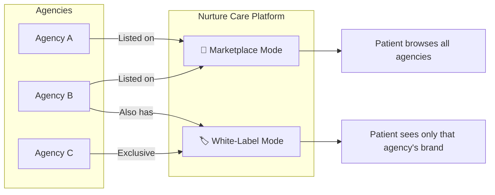
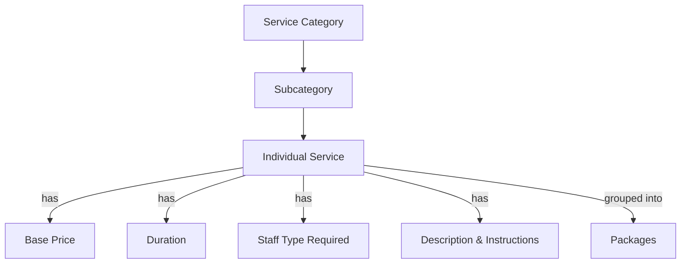
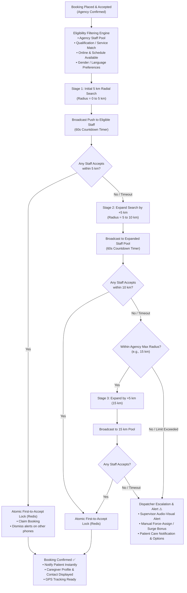
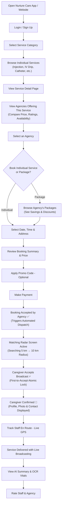
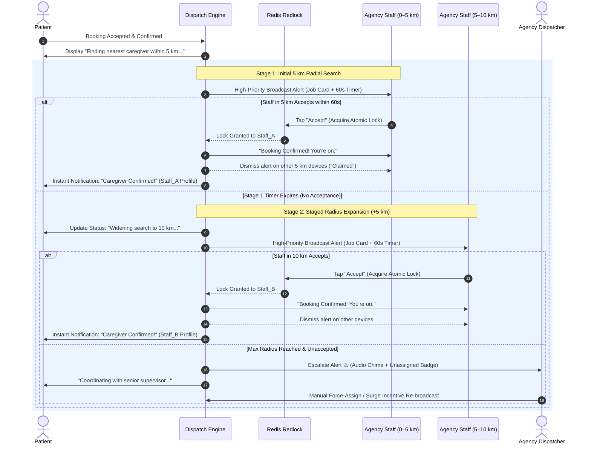
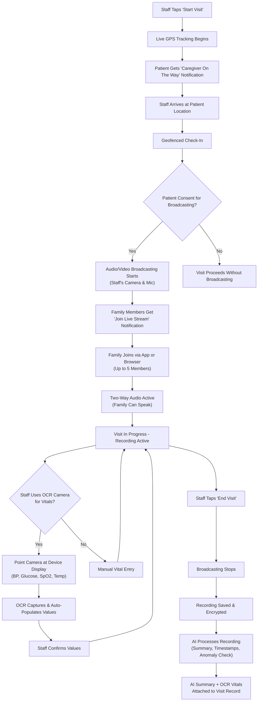
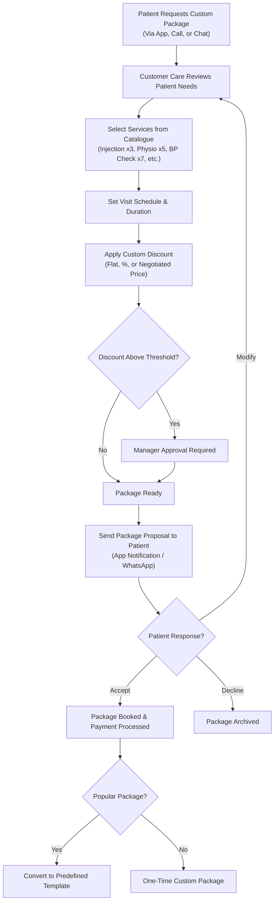
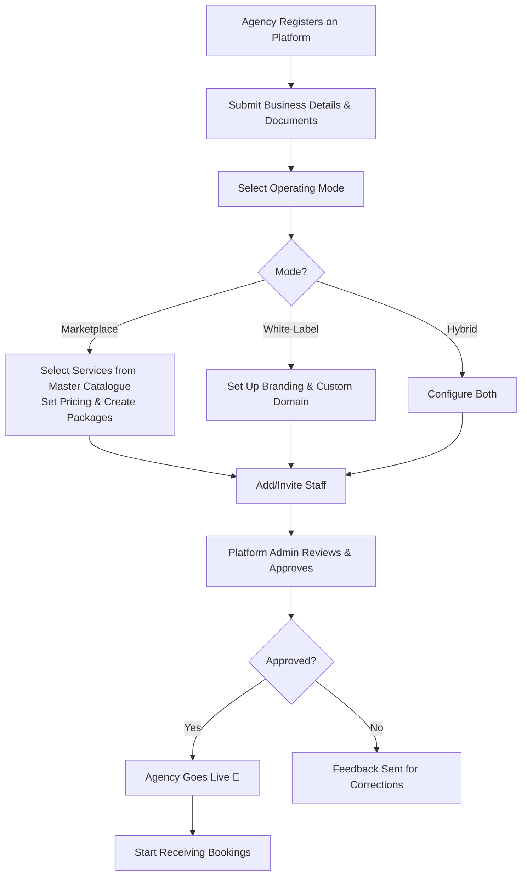
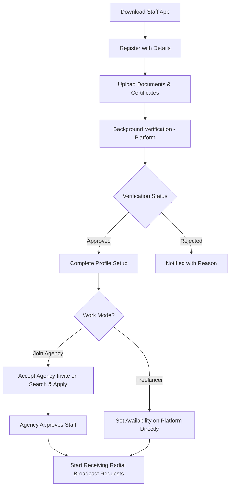

# 🏥 Home Care with Paramedical Staff — Requirement Document

> **Version:** 2.4  
> **Date:** October 25, 2026  
> **Prepared by:** Ravi Ranjan  
> **Status:** Active Reference & Specification  
> **Change Log:**  
> - v2.0 — Added Multi-Agency Marketplace Model  
> - v2.1 — Added Individual Service Listings, Enhanced Package System with Discounting, Live Visit Broadcasting, AI-Powered Visit Intelligence & OCR  
> - v2.2 — Added Automated Booking Confirmation & Dynamic Multi-Stage Radius Broadcast Dispatch (5km Initial + 5km Staged Expansion, First-to-Accept Atomic Lock, Instant Customer Notification)  
> - v2.3 — Added Multi-Select Clinical Categories across catalogue & staff, 3-Step Paramedical Verification & Dispatch Enablement Lifecycle, Unified Package Builder with Procedure Inclusions, and Agency Customer Care Manual Staff Assignment Modal  
> - v2.4 — Added Passwordless OTP Authentication (SMS/Email simulation with SSE real-time notification broker & SQLite persistence), Inline Modal OTP Banners with 1-Click Auto-Fill, Auto-Derived Package Categories from Selected Services, and Strict Customer Isolation for Enrolled Packages & Booking History

---

## 1. Executive Summary

This document outlines the functional and non-functional requirements for a **Home Care Platform** — a mobile application (iOS & Android) and responsive website — that connects **patients/families** with qualified **paramedical staff** (nurses, physiotherapists, lab technicians, attendants, etc.) for in-home healthcare services.

The platform operates as a **multi-agency marketplace** where multiple home care agencies can onboard, list their service packages, and manage their own operations. Agencies have two operating modes:

1. **White-Label Mode** — The agency gets a fully customized, branded experience (custom home page, logo, colors, domain) making it appear as if the app/website belongs entirely to them.
2. **Marketplace Mode** — The agency is listed on the main Nurture Care platform alongside other agencies, allowing patients to browse, compare, and choose the same service across multiple agencies based on pricing, ratings, and availability.

Key architectural and operational pillars include:
- **Automated Booking Confirmation & Dynamic Radius Broadcast Dispatch** — When a booking is accepted, the system instantly broadcasts the request to all nearby eligible paramedical staff within an initial **5 km radius**. If no staff accepts within the configured window, the search radius automatically expands in **5 km increments** (to 10 km, 15 km, etc.). The first eligible staff member to accept is atomically assigned and confirmed, triggering instant customer notifications.
- **Comprehensive Service & Package Architecture** — Master catalogue of individual clinical services (injection, IV drip, catheterization, wound dressing, etc.) alongside pre-defined bundled packages and on-demand custom packages created by customer care with configurable discounts.
- **Live Visit Broadcasting & Safety** — Live GPS tracking en route, automatic audio/video broadcasting upon arrival for authorized family monitoring with two-way audio, and tamper-proof encrypted recordings.
- **AI-Powered Visit Intelligence & OCR** — Automatic visit transcription, summaries, clinical timeline extraction, anomaly/distress detection, and camera-based OCR vital signs capture (BP, blood glucose, SpO2, temperature).

---

## 2. Project Objectives

| # | Objective |
|---|-----------|
| 1 | Provide an easy-to-use digital platform for patients/families to book paramedical home care services |
| 2 | Enable paramedical professionals to register, manage availability, and accept service requests |
| 3 | **Onboard multiple home care agencies** that can list packages, manage staff, and run operations independently |
| 4 | **Provide white-label capability** — agencies get a customized home page/app experience branded as their own |
| 5 | **Build a marketplace** — agencies are listed on the platform for patients to compare services across providers |
| 6 | **Automate booking confirmation & rapid caregiver dispatch** via staged radial broadcast (5 km initial + 5 km increments) and atomic first-to-accept locking |
| 7 | Ensure transparent pricing, secure payments, and digital invoicing |
| 8 | Maintain quality of care through ratings, reviews, and credential verification |
| 9 | Provide real-time tracking and communication between patients and caregivers |
| 10 | **Enable live audio/video broadcasting of visits** for family monitoring, with AI-powered summaries |
| 11 | **Automate health data capture** via OCR for vitals like BP, glucose, SpO2, temperature |
| 12 | Offer a super-admin dashboard for platform-level operations management, analytics, and compliance |

---

## 3. Platform Architecture — Multi-Agency Model

### 3.1 Operating Modes

| Mode | Description | Use Case |
|------|-------------|----------|
| **Marketplace** | Agency is listed on the main Nurture Care platform. Patients can browse, compare, and book services across multiple agencies. The platform controls the overall UX. | Agencies wanting visibility and patient acquisition through the platform |
| **White-Label** | Agency gets a fully branded experience — custom logo, colors, domain/subdomain, home page, and app splash screen. Patients interact as if the app belongs entirely to the agency. | Agencies wanting their own digital presence powered by Nurture Care infrastructure |
| **Hybrid** | Agency operates in both modes simultaneously — listed on the marketplace AND has its own white-label portal. | Agencies wanting both visibility and independent brand presence |

### 3.2 Multi-Tenancy Architecture

| Aspect | Approach |
|--------|----------|
| **Data Isolation** | Tenant-level data separation — each agency's staff, bookings, and patient data are logically isolated |
| **Shared Infrastructure** | Common backend, database (multi-tenant), payment processing, and notification services |
| **Customization Layer** | Per-agency theming engine (logo, colors, fonts, home page layout, custom domain) |
| **Dispatch Isolation** | Dispatch broadcasts are scoped strictly to the selected agency's staff pool (or platform pool for freelance staff) |
| **Billing** | Platform charges agencies via subscription or commission model (configurable) |

---

## 4. Target Users (Personas)

### 4.1 Patient / Family Member
- Individuals needing home healthcare for themselves or family members (elderly, post-surgery, chronic illness, newborn care)
- Age group: 25–70 years
- Tech comfort: Basic to moderate
- **Marketplace patients**: Discover and compare agencies on the platform
- **White-label patients**: Access services through a specific agency's branded portal

### 4.2 Paramedical Staff (Service Provider)
- Licensed/certified nurses, physiotherapists, lab technicians, home attendants, midwives, dietitians
- Looking for flexible work, additional income, or full-time home care assignments
- **Associated with an agency or working as platform-direct freelancers**
- Receives radial broadcast requests on mobile app with countdown timer to accept jobs

### 4.3 Agency Owner / Manager
- Home care agency operators who want to digitize their operations
- Manage their own staff pool, service packages, pricing, branding, and dispatch parameters
- Can operate in Marketplace mode, White-Label mode, or both

### 4.4 Customer Care Executive
- Platform or agency-level support staff who can **create custom on-demand packages** based on patient needs
- Monitor live dispatch exceptions, handle unassigned bookings, disputes, and rescheduling

### 4.5 Platform Super-Admin
- Nurture Care platform administrators managing agency onboarding, platform-wide quality, disputes, analytics, and compliance

### 4.6 Corporate / Hospital Partners (Phase 3)
- Hospitals, clinics, and corporates outsourcing home care to agencies on the platform

---

## 5. Service Categories & Individual Service Catalogue

### 5.1 Master Service Catalogue Structure

The platform maintains a **hierarchical service catalogue**: Category → Subcategory → Individual Service. Each individual service has its own listing screen with description, pricing, duration, and staff requirements.

### 5.2 Detailed Service Catalogue

#### 🩺 Nursing Care
| Service ID | Individual Service | Typical Duration | Staff Required |
|------------|-------------------|------------------|----------------|
| NUR-001 | Injection (IM/IV/SC) | 15–30 min | Nurse |
| NUR-002 | IV Drip / Infusion | 1–3 hours | Nurse |
| NUR-003 | Catheter Insertion / Removal | 30–45 min | Nurse |
| NUR-004 | Catheter Care & Maintenance | 20–30 min | Nurse |
| NUR-005 | Wound Dressing & Care | 30–60 min | Nurse |
| NUR-006 | Stoma Care (Colostomy/Ileostomy) | 30–45 min | Nurse |
| NUR-007 | Ryle's Tube / Feeding Tube Insertion | 30–45 min | Nurse |
| NUR-008 | Nasogastric (NG) Feeding | 20–30 min | Nurse |
| NUR-009 | Tracheostomy Care | 30–45 min | Nurse |
| NUR-010 | Nebulization | 15–20 min | Nurse |
| NUR-011 | Vital Signs Monitoring (BP, Temp, SpO2, Pulse) | 15–20 min | Nurse |
| NUR-012 | Blood Sugar (Glucose) Check | 10–15 min | Nurse |
| NUR-013 | Bedsore / Pressure Sore Care | 30–60 min | Nurse |
| NUR-014 | Post-Surgical Drain Management | 30–45 min | Nurse |
| NUR-015 | Enema Administration | 30–45 min | Nurse |
| NUR-016 | Oxygen Therapy Setup & Monitoring | 30 min + monitoring | Nurse |
| NUR-017 | Suture / Staple Removal | 20–30 min | Nurse |
| NUR-018 | Vaccination / Immunization | 15–20 min | Nurse |

#### 🏋️ Physiotherapy
| Service ID | Individual Service | Typical Duration | Staff Required |
|------------|-------------------|------------------|----------------|
| PHY-001 | Post-Knee Replacement Rehab | 45–60 min | Physiotherapist |
| PHY-002 | Post-Hip Replacement Rehab | 45–60 min | Physiotherapist |
| PHY-003 | Post-Fracture Rehabilitation | 45–60 min | Physiotherapist |
| PHY-004 | Stroke / Neuro Rehabilitation | 45–60 min | Physiotherapist |
| PHY-005 | Spinal Cord Injury Rehab | 45–60 min | Physiotherapist |
| PHY-006 | Frozen Shoulder Therapy | 30–45 min | Physiotherapist |
| PHY-007 | Back Pain / Sciatica Treatment | 30–45 min | Physiotherapist |
| PHY-008 | Cervical Spondylosis Therapy | 30–45 min | Physiotherapist |
| PHY-009 | Geriatric Mobility & Strength | 30–45 min | Physiotherapist |
| PHY-010 | Chest Physiotherapy | 30–45 min | Physiotherapist |
| PHY-011 | Post-Cardiac Surgery Rehab | 45–60 min | Physiotherapist |
| PHY-012 | Sports Injury Rehabilitation | 45–60 min | Physiotherapist |
| PHY-013 | Paralysis / Paresis Therapy | 45–60 min | Physiotherapist |

#### 👴 Elderly / Attendant Care
| Service ID | Individual Service | Typical Duration | Staff Required |
|------------|-------------------|------------------|----------------|
| ELD-001 | 24/7 Live-In Attendant | 24 hours (shift) | Attendant |
| ELD-002 | 12-Hour Day/Night Attendant | 12 hours | Attendant |
| ELD-003 | Daily Hygiene & Bathing Assistance | 1–2 hours | Attendant |
| ELD-004 | Companionship & Mental Stimulation | 2–4 hours | Attendant |
| ELD-005 | Mobility & Walking Support | 1–2 hours | Attendant |
| ELD-006 | Feeding & Nutrition Assistance | 1 hour | Attendant |
| ELD-007 | Medication Reminders & Administration | 30 min / visit | Attendant/Nurse |
| ELD-008 | Incontinence Care | 30–60 min | Attendant/Nurse |

#### 🤱 Mother & Baby Care
| Service ID | Individual Service | Typical Duration | Staff Required |
|------------|-------------------|------------------|----------------|
| MBC-001 | Post-Natal Mother Care | 4–8 hours | Nurse/Midwife |
| MBC-002 | Lactation Support & Guidance | 1–2 hours | Lactation Consultant |
| MBC-003 | Newborn Bathing & Cord Care | 30–45 min | Nurse |
| MBC-004 | Baby Massage | 30–45 min | Trained Attendant |
| MBC-005 | Vaccination Schedule & Administration | 15–30 min | Nurse |
| MBC-006 | C-Section Wound Care | 30–45 min | Nurse |
| MBC-007 | 24/7 Baby Nurse / Nanny | 24 hours (shift) | Baby Nurse |

#### 🔬 Lab & Diagnostics (At Home)
| Service ID | Individual Service | Typical Duration | Staff Required |
|------------|-------------------|------------------|----------------|
| LAB-001 | Blood Sample Collection (CBC, LFT, KFT, etc.) | 15–20 min | Phlebotomist |
| LAB-002 | Urine Sample Collection | 10 min | Lab Tech |
| LAB-003 | ECG at Home | 20–30 min | ECG Tech |
| LAB-004 | X-Ray at Home (Portable) | 30–45 min | X-Ray Tech |
| LAB-005 | Full Body Health Check-Up Package | 30–45 min | Lab Tech/Nurse |
| LAB-006 | Diabetes Screening Package | 20–30 min | Lab Tech |
| LAB-007 | Thyroid Profile Test | 15–20 min | Phlebotomist |
| LAB-008 | COVID/Flu RT-PCR / Antigen Test | 15–20 min | Lab Tech |

#### 🏥 Specialized Care
| Service ID | Individual Service | Typical Duration | Staff Required |
|------------|-------------------|------------------|----------------|
| SPC-001 | Home Dialysis Support | 4–5 hours | Dialysis Nurse |
| SPC-002 | Ventilator Care at Home | 24 hours (shift) | ICU Nurse |
| SPC-003 | ICU-Level Care at Home | 24 hours (shift) | ICU Nurse |
| SPC-004 | Palliative / End-of-Life Care | 4–24 hours | Palliative Nurse |
| SPC-005 | Chemotherapy Support at Home | 3–5 hours | Oncology Nurse |
| SPC-006 | BiPAP / CPAP Setup & Monitoring | 1–2 hours | Respiratory Tech |

#### 🧠 Mental Health
| Service ID | Individual Service | Typical Duration | Staff Required |
|------------|-------------------|------------------|----------------|
| MH-001 | Counselling Session (Individual) | 45–60 min | Counsellor |
| MH-002 | Psychiatric Nurse Visit | 30–60 min | Psychiatric Nurse |
| MH-003 | Cognitive Behavioural Therapy (CBT) | 45–60 min | Therapist |
| MH-004 | Geriatric Mental Health Support | 45–60 min | Counsellor |
| MH-005 | Caregiver Burnout Counselling | 45–60 min | Counsellor |

#### 🥗 Dietetics & Nutrition
| Service ID | Individual Service | Typical Duration | Staff Required |
|------------|-------------------|------------------|----------------|
| DT-001 | Personalized Diet Plan | 45–60 min | Dietitian |
| DT-002 | Diabetes Diet Management | 45–60 min | Dietitian |
| DT-003 | Post-Surgery Nutritional Assessment | 45–60 min | Dietitian |
| DT-004 | Weight Management Program | 45–60 min | Dietitian |
| DT-005 | Renal / Cardiac Diet Planning | 45–60 min | Dietitian |

### 5.3 Individual Service Listing Screen

Each individual service gets its own dedicated listing page containing:

| Element | Description |
|---------|-------------|
| **Service Name & Icon** | Clear identification with category badge |
| **Description** | What the service involves, when it's needed |
| **Duration** | Estimated time for the service |
| **Base Price** | Platform-suggested base price (agency can override) |
| **Agencies Offering** | List of agencies offering this service (marketplace mode) with price comparison |
| **Staff Profiles** | Available staff qualified for this service |
| **What's Included** | Itemized list (e.g., supplies, disposables, report) |
| **Preparation Instructions** | What the patient should do before the visit |
| **FAQs** | Common questions about the service |
| **Related Packages** | Packages that include this service |
| **Reviews** | Service-specific ratings and reviews |

---

## 6. Functional Requirements

### 6.1 Agency Portal (App & Web Dashboard)

#### 6.1.1 Agency Onboarding & Registration
| ID | Requirement | Priority |
|----|-------------|----------|
| AG-001 | Register agency with business name, registration number, GSTIN, contact details | High |
| AG-002 | Upload business documents: trade license, healthcare license, GST certificate, PAN | High |
| AG-003 | Select operating mode: Marketplace, White-Label, or Hybrid | High |
| AG-004 | Define service areas (cities, pin codes, maximum operational radius) | High |
| AG-005 | Choose service categories and **individual services** from the platform's master catalogue | High |
| AG-006 | Admin verification and approval workflow for agency registration | High |
| AG-007 | Agency onboarding tutorial / guided setup wizard | Medium |

#### 6.1.2 White-Label Customization
| ID | Requirement | Priority |
|----|-------------|----------|
| AG-010 | Upload agency logo, favicon, and brand assets | High |
| AG-011 | Configure brand colors (primary, secondary, accent) and typography | High |
| AG-012 | Customize home page layout — hero banner, featured services, testimonials, about section | High |
| AG-013 | Set custom domain or subdomain (e.g., `agencyname.nurturecare.in` or `care.agencyname.com`) | High |
| AG-014 | Customize app splash screen and app icon (for white-label app builds) | Medium |
| AG-015 | Add custom pages: About Us, Our Team, Contact, Blog | Medium |
| AG-016 | Configure email templates with agency branding (booking confirmation, reminders) | Medium |
| AG-017 | Enable/disable platform branding (e.g., "Powered by Nurture Care" footer) | Medium |
| AG-018 | Preview white-label site/app before publishing | High |
| AG-019 | Custom welcome message and onboarding flow for patients entering via white-label | Medium |

#### 6.1.3 Service & Package Management
| ID | Requirement | Priority |
|----|-------------|----------|
| AG-020 | **Enable/disable individual services** from the master catalogue for the agency | High |
| AG-021 | **Set agency-specific pricing** for each individual service | High |
| AG-022 | **Create predefined packages** (e.g., "Post-Surgery Recovery — 7 Day Package") by bundling individual services | High |
| AG-023 | Define package contents: included services (from catalogue), visit count per service, duration, staff type | High |
| AG-024 | **Set package pricing** — can be lower than sum of individual services (built-in package discount) | High |
| AG-025 | Create subscription plans (monthly, quarterly, annual) | High |
| AG-026 | Configure service add-ons (e.g., extra medication supplies, weekend surcharge) | Medium |
| AG-027 | Set service availability by day/time (e.g., 24/7 vs business hours only) | High |
| AG-028 | Publish/unpublish services and packages | High |
| AG-029 | Clone and modify existing packages for quick creation | Low |

#### 6.1.4 Discount & Pricing Engine
| ID | Requirement | Priority |
|----|-------------|----------|
| AG-070 | **Percentage-based discount** on packages (e.g., 15% off on 10-visit nursing package) | High |
| AG-071 | **Flat amount discount** on packages (e.g., ₹500 off) | High |
| AG-072 | **Combo / bundle discount** — automatic discount when multiple services are combined into a package | High |
| AG-073 | **Tiered pricing** — lower per-visit cost for longer commitments (e.g., 7-day < 14-day < 30-day) | High |
| AG-074 | **Early bird discount** — discount for advance bookings (e.g., book 7 days early, get 10% off) | Medium |
| AG-075 | **Loyalty discount** — automatic discount for repeat patients | Medium |
| AG-076 | **Custom promo codes** — agency can create codes for specific patients or campaigns | Medium |
| AG-077 | **Show savings** — display "You save ₹X" or "X% off" on package vs individual booking | High |
| AG-078 | **Discount validity period** — set start/end dates for any discount or offer | Medium |
| AG-079 | **Minimum order value** for discount applicability | Low |

#### 6.1.5 Unified Package Creation & Custom Care Plan Engine
| ID | Requirement | Priority |
|----|-------------|----------|
| AG-080 | **Single, Unified Package Creation Experience**: One consistent package creation flow and modal used across both Agency Administration and Customer Care Desk | High |
| AG-081 | **Target Scope Selection**: Switch seamlessly between **Public Agency Package** (visible across marketplace) and **Customer-Specific Package** (tagged to a patient ID with 14-day auto-expiry) | High |
| AG-082 | **Auto-Derived Package Categories & Category-Filtered Procedure Picker**: Package clinical categories are automatically derived and updated in a text field based on the included services. Services can be filtered with 1-click quick-category tabs (`All`, `Nursing`, `Physiotherapy`, `Elderly Care`, `Lab & Diagnostics`) with session counts | High |
| AG-083 | **Individual Procedure Picker**: Search and add specific procedures from the active service catalogue with customizable session/visit counts | High |
| AG-084 | **Itemized Cost & Retail Sum**: Automatically compute the total retail price as $\sum (\text{unit price} \times \text{sessions})$ and display an itemized procedures table | High |
| AG-085 | **Interactive Package Discount Engine**: Real-time slider and numeric input for package discount (0–90%), calculating net offered price and highlighting patient savings (e.g., "Save ₹2,000") | High |
| AG-086 | **Auto-Calculated Totals**: Persist aggregated session counts, duration (days), final package price, original price, discount percentage, and itemized procedure JSON | High |
| AG-087 | **Customer Expiry & Notification**: Customer-tagged packages notify the patient, display exclusively in their portal, and auto-expire after 14 days if unpurchased | High |

#### 6.1.6 Staff Management & 3-Step Verification Lifecycle
| ID | Requirement | Priority |
|----|-------------|----------|
| AG-030 | **Step 1: Paramedical Registration / Onboarding**: Add/invite staff to agency roster. Captures credentials, license number, Aadhaar/ID proof, police verification doc, service area, and multi-select clinical categories | High |
| AG-031 | **Multi-Select Clinical Categories for Staff**: Staff can specify multiple clinical qualifications (e.g., `'Nursing, Physiotherapy'`) enabling dispatch eligibility across multiple care categories | High |
| AG-032 | **Step 2: Credential Verification**: Agency admin verifies uploaded clinical licenses and background documents, recording an audit note and setting status to `VERIFIED` | High |
| AG-033 | **Step 3: Dispatch Enablement**: Explicit toggle to enable/disable staff for live dispatch. System strictly prevents enabling unverified staff | High |
| AG-034 | View staff availability, live GPS locations, and auto-dispatch status | High |
| AG-035 | Set staff commission/payout structure at agency level | High |
| AG-036 | Monitor staff performance (ratings, on-time %, completion rate, broadcast accept rate) | High |
| AG-037 | Suspend or remove staff from agency pool | Medium |
| AG-037 | Staff can belong to multiple agencies (if allowed by agency settings) | Medium |

#### 6.1.7 Booking & Request Management & Automated Dispatch Configuration
| ID | Requirement | Priority |
|----|-------------|----------|
| AG-040 | View all incoming booking requests (from marketplace or white-label) | High |
| AG-041 | Accept, decline, or cancel booking requests with automated replacement routing | High |
| AG-041b | **Customer Care Desk Staff Assignment Modal**: Dedicated assignment & reassignment interface on care queue. Displays verified on-duty agency staff, real-time distance in km, ratings, clinical categories, and 1-tap instant assignment | High |
| AG-041c | **Role Separation for Vitals Entry vs Care Oversight**: Vital sign recording (BP, SpO2, Pulse) and clinical sign-off is restricted strictly to on-duty paramedics. Agency Care Coordinators and Admins view read-only audit records and consultation transcripts | High |
| AG-042 | Dashboard view: live dispatching, upcoming, ongoing, completed, unassigned/escalated | High |
| AG-043 | Manage cancellations and rescheduling for agency bookings | High |
| AG-044 | **Enable/Configure Automated Booking Dispatch**: toggle auto-dispatch on/off per service category | High |
| AG-045 | **Configure Radius Stages**: set Initial Search Radius (default: 5 km), Step Increment (default: +5 km), and Maximum Radial Limit (e.g., 20 km) | High |
| AG-046 | **Configure Acceptance Window / Timeout**: set countdown timer per stage (default: 60 seconds per 5 km stage) | High |
| AG-047 | **Configure Auto-Accept for Bookings**: automatically accept customer bookings upon payment confirmation and immediately trigger broadcast engine | High |
| AG-048 | **Dispatcher Live Monitor & Audio Alerts**: real-time map board showing active broadcasts, radius expansion progress, and audio alerts for unassigned requests | High |
| AG-049 | **Manual Force-Assign Override**: supervisor can immediately assign an unfulfilled booking to a specific staff member, overriding the auto-broadcast | High |

#### 6.1.8 Agency Analytics & Finance
| ID | Requirement | Priority |
|----|-------------|----------|
| AG-050 | Revenue dashboard: daily, weekly, monthly, custom date range | High |
| AG-051 | Booking analytics: conversion rate, cancellation rate, repeat rate, **dispatch fulfillment time** | High |
| AG-052 | Staff utilization reports and broadcast acceptance velocity | High |
| AG-053 | Patient acquisition source tracking (marketplace vs white-label vs referral) | Medium |
| AG-054 | Financial reports: earnings, platform commission, net payout, taxes | High |
| AG-055 | Export reports as CSV / PDF | Medium |
| AG-056 | View and manage platform commission/subscription billing | High |
| AG-057 | **Package performance analytics** — which packages sell most, custom vs predefined breakdown | Medium |
| AG-058 | **Discount impact analysis** — revenue impact of discounts offered | Medium |

#### 6.1.9 Agency Communication
| ID | Requirement | Priority |
|----|-------------|----------|
| AG-060 | In-app messaging with patients for agency-level support | High |
| AG-061 | Broadcast notifications to agency's staff pool | Medium |
| AG-062 | Manage agency-specific promo codes and offers | Medium |
| AG-063 | Respond to patient reviews at agency level | Medium |

---

### 6.2 Patient / Family App & Website

#### 6.2.1 Onboarding & Authentication
| ID | Requirement | Priority |
|----|-------------|----------|
| P-001 | Sign up via mobile number (OTP), email, or social login (Google/Apple) | High |
| P-002 | Create patient profile with name, age, gender, medical conditions, address(es) | High |
| P-003 | Add multiple family members / care recipients under one account | High |
| P-004 | Emergency contact information storage | Medium |
| P-005 | **Marketplace entry**: Patient lands on main Nurture Care platform with all agencies listed | High |
| P-006 | **White-label entry**: Patient lands on agency-branded portal (sees only that agency's services) | High |

#### 6.2.2 Service Discovery, Booking & Live Confirmation
| ID | Requirement | Priority |
|----|-------------|----------|
| P-010 | Browse services by **category → individual service** (e.g., Nursing → IV Drip, Injection, Catheter) | High |
| P-011 | **Individual service listing page** with description, duration, price, agencies, reviews | High |
| P-012 | Search for specific services or conditions (e.g., "post-knee replacement physio", "IV drip") | High |
| P-013 | **View and compare agencies** offering the same individual service — side-by-side pricing, ratings, experience | High |
| P-014 | **Filter agencies** by rating, price range, distance, availability, response time | High |
| P-015 | View agency profiles: logo, description, staff count, ratings, packages, certifications | High |
| P-016 | View individual staff profiles: photo, qualifications, experience, ratings, languages spoken | High |
| P-017 | Check real-time availability of staff for a given date/time/location | High |
| P-018 | Book **individual services** (single session of a specific service) | High |
| P-019 | Book **predefined packages** offered by agencies | High |
| P-020 | Book **recurring** visits (daily, weekly, custom schedule) | High |
| P-021 | Book **long-term** assignments (24/7 attendant, live-in nurse) — weekly/monthly | High |
| P-022 | Select preferred gender of caregiver | Medium |
| P-023 | Specify special requirements (language, equipment, medical history upload) | Medium |
| P-024 | Get instant price estimate before booking confirmation | High |
| P-025 | **View package savings** — see "You save ₹X" when booking a package vs individual services | High |
| P-026 | Schedule booking for a future date or request immediate/ASAP service | High |
| P-027 | **"Same Service, Multiple Agencies" view** — select a service and see all agencies offering it with comparative pricing | High |
| P-028 | **Request custom package** — describe needs and get a tailored package from customer care | Medium |
| P-029a | **Real-Time Matching Radar Screen**: upon booking acceptance, patient sees animated matching radar: "Contacting qualified caregivers within 5 km..." | High |
| P-029b | **Dynamic Radius Expansion Status**: if expanding beyond 5 km, radar updates smoothly: "Widening search to 10 km to find the best available caregiver..." | High |
| P-029c | **Instant Caregiver Confirmed Screen**: as soon as a staff member accepts, the screen transitions to "Caregiver Confirmed! 🎉" with full profile (photo, name, qualification, rating, contact) | High |
| P-029d | **Immediate Multichannel Confirmation**: instant push notification, SMS, and WhatsApp message sent with confirmation details and caregiver credentials | High |
| P-029e | **Customer Contact & OTP Verification before Booking & Enrollment**: Patient specifies phone number or email and must verify a 6-digit OTP before single-session booking or multi-day package enrollment confirmation is dispatched. | High |

#### 6.2.3 Service Discovery & Booking (White-Label Mode)
| ID | Requirement | Priority |
|----|-------------|----------|
| P-030 | Browse only the specific agency's service catalogue (**categories → individual services**) and packages | High |
| P-031 | See agency-branded UI (logo, colors, custom home page) | High |
| P-032 | All booking flows scoped strictly to that agency's staff pool and pricing | High |
| P-033 | No visibility of other agencies or marketplace comparison | High |
| P-034 | Optional "Explore more on Nurture Care" link (configurable by agency) | Low |

#### 6.2.4 Real-Time Tracking & Communication
| ID | Requirement | Priority |
|----|-------------|----------|
| P-040 | **Live GPS tracking starts automatically** when staff initiates the visit / starts travelling | High |
| P-041 | Track assigned staff's live location on map with **real-time ETA** (en route to patient) | High |
| P-042 | In-app chat with assigned caregiver | High |
| P-043 | In-app voice/video call with caregiver (before arrival) | Medium |
| P-044 | Receive push notifications for booking confirmation, staff departure, arrival, visit completion | High |
| P-045 | SMS/WhatsApp fallback notifications | Medium |
| P-046 | **Notifications branded with agency name** (in white-label mode) | Medium |

#### 6.2.5 Payments & Billing
| ID | Requirement | Priority |
|----|-------------|----------|
| P-050 | Multiple payment options: UPI, Credit/Debit Cards, Net Banking, Wallets | High |
| P-051 | Pay-per-visit, package billing, or subscription billing | High |
| P-052 | Digital invoice/receipt generation (GST-compliant, **with agency branding** in white-label) | High |
| P-053 | Apply promo codes and referral discounts (platform-level and agency-level) | Medium |
| P-054 | **View package discounts and savings** on invoice | Medium |
| P-055 | Wallet system for quick payments and refunds | Medium |
| P-056 | Auto-debit for recurring bookings (with consent) | Low |

#### 6.2.6 Post-Service & Quality
| ID | Requirement | Priority |
|----|-------------|----------|
| P-060 | Rate and review the caregiver after each visit (1–5 stars + text) | High |
| P-061 | **Rate and review the agency** separately from individual staff | High |
| P-062 | View digital visit summary / care notes uploaded by caregiver | High |
| P-063 | **View AI-generated visit summary** (from audio/video recording) | High |
| P-064 | **Access visit recording** (audio/video) for review | High |
| P-065 | **View OCR-captured vitals** (BP, glucose, SpO2, temperature) in structured format | High |
| P-066 | Access visit history and medical records/reports | High |
| P-067 | Raise a complaint or dispute for any visit | High |
| P-068 | Request the same caregiver for future visits ("Favourite" feature) | Medium |
| P-069 | Share health reports with family members or doctors | Medium |
| P-070 | **Switch between agencies** for future bookings if not satisfied | Medium |

---

### 6.3 Live Visit Broadcasting & Monitoring

> [!IMPORTANT]
> This feature ensures **full transparency and safety** during home visits. When the paramedical staff arrives at the patient's location, live audio/video broadcasting begins, allowing family members to monitor the visit in real-time.

#### 6.3.1 Live Tracking During Transit
| ID | Requirement | Priority |
|----|-------------|----------|
| LV-001 | **Auto-start GPS tracking** when staff taps "Start Visit" / "On My Way" in the app | High |
| LV-002 | Patient and family members see live location on map with ETA | High |
| LV-003 | Push notification to patient: "Your caregiver is on the way" with live tracking link | High |
| LV-004 | Shareable tracking link for family members (no app required, works in browser) | High |
| LV-005 | Geofence detection: auto-notify when staff is within 500m of destination | Medium |

#### 6.3.2 Live Audio/Video Broadcasting
| ID | Requirement | Priority |
|----|-------------|----------|
| LV-010 | **Audio/video broadcasting auto-starts** when staff checks in at the patient location (geofenced) | High |
| LV-011 | Staff's device camera and microphone stream live to the patient's connected family members | High |
| LV-012 | **Patient consent required** before broadcasting begins (one-time or per-visit consent) | High |
| LV-013 | Family members receive notification with **"Join Live Stream"** button | High |
| LV-014 | **Multiple family members** can join the live stream simultaneously (up to 5) | High |
| LV-015 | **Two-way audio**: Family members can speak / give instructions during the visit (push-to-talk or always-on, configurable) | High |
| LV-016 | One-way video by default (staff's camera → family); family can optionally enable their video | Medium |
| LV-017 | Staff can **pause video** briefly for patient privacy moments (e.g., changing clothes) with timestamp log | Medium |
| LV-018 | Low-bandwidth mode: auto-switch to audio-only in poor network conditions | Medium |
| LV-019 | Broadcasting continues until staff taps "End Visit" / checks out | High |
| LV-020 | Visual indicator on staff's app showing "Live Broadcasting Active" with viewer count | High |

#### 6.3.3 Visit Recording
| ID | Requirement | Priority |
|----|-------------|----------|
| LV-030 | **Full visit recording** (audio + video) saved automatically | High |
| LV-031 | Recording attached to the visit record, accessible by patient, family, and agency | High |
| LV-032 | **Encrypted storage** — recordings stored with AES-256 encryption | High |
| LV-033 | Configurable retention period (e.g., 30 days, 90 days, 1 year) by agency/platform | High |
| LV-034 | Patient can download recording within retention period | Medium |
| LV-035 | Recording access log — track who viewed/downloaded the recording | Medium |
| LV-036 | Auto-delete after retention period with notification to patient | Medium |
| LV-037 | **Tamper-proof recording** — recordings cannot be edited or deleted by staff or agency | High |

#### 6.3.4 Family Member Access
| ID | Requirement | Priority |
|----|-------------|----------|
| LV-040 | Patient can add **authorized family members** who receive live stream access | High |
| LV-041 | Family members can join via mobile app or web browser (no app installation required for web) | High |
| LV-042 | Family member authentication via OTP before joining live stream | High |
| LV-043 | Family members can view past visit recordings (if authorized by patient) | Medium |
| LV-044 | Notification preferences per family member (all visits, specific visits, emergency only) | Medium |

---

### 6.4 AI-Powered Visit Intelligence

> [!IMPORTANT]
> AI capabilities ensure automated documentation, security audit trail, and intelligent health data capture from every visit.

#### 6.4.1 AI Audio/Video Summary
| ID | Requirement | Priority |
|----|-------------|----------|
| AI-001 | **AI-generated text summary** of the entire visit from audio/video recording | High |
| AI-002 | Summary includes: services performed, medications administered, patient observations, instructions given | High |
| AI-003 | **Timestamped key moments** — AI identifies and bookmarks important events (e.g., "12:05 — Injection administered", "12:20 — BP measured") | High |
| AI-004 | **Sentiment analysis** — flag visits where patient appeared distressed, uncomfortable, or in pain | Medium |
| AI-005 | **Anomaly detection** — flag unusual events (raised voices, long silences, staff leaving room for extended period) | High |
| AI-006 | **Multi-language support** — AI can summarize visits conducted in Hindi, English, and regional languages | Medium |
| AI-007 | Summary available within 30 minutes of visit completion | High |
| AI-008 | Patient and family can view AI summary alongside the recording | High |
| AI-009 | Agency admin and platform admin can access AI summaries for quality audits | High |
| AI-010 | **AI compliance check** — verify if all booked services were actually performed during the visit | Medium |

#### 6.4.2 OCR-Based Vital Signs Capture
| ID | Requirement | Priority |
|----|-------------|----------|
| AI-020 | **OCR reader for BP monitors** — staff points camera at BP machine display, OCR captures systolic/diastolic/pulse readings | High |
| AI-021 | **OCR reader for glucometers** — captures blood glucose readings from device display | High |
| AI-022 | **OCR reader for pulse oximeters** — captures SpO2 and pulse rate from device display | High |
| AI-023 | **OCR reader for thermometers** — captures temperature readings (digital displays) | High |
| AI-024 | **OCR reader for weight scales** — captures weight readings | Medium |
| AI-025 | **Auto-populate vitals** into the visit care notes and patient health record | High |
| AI-026 | Staff can verify and confirm/edit OCR-captured values before saving | High |
| AI-027 | Historical trend charts for captured vitals (BP over time, glucose over time, etc.) | High |
| AI-028 | **Abnormal value alerts** — flag readings outside normal range (e.g., BP > 140/90, glucose > 200 mg/dL) | High |
| AI-029 | Alert sent to patient, family, and agency if critical vital signs detected | High |
| AI-030 | **OCR for prescriptions and reports** — scan and digitize handwritten/printed prescriptions, lab reports | Medium |
| AI-031 | Extracted data stored in structured format (JSON) for analytics and sharing | Medium |
| AI-032 | OCR works offline — capture now, process when network available | Medium |

---

### 6.5 Paramedical Staff App

#### 6.5.1 Onboarding & Verification
| ID | Requirement | Priority |
|----|-------------|----------|
| S-001 | Register with personal details, qualifications, certifications, experience | High |
| S-002 | Upload documents: nursing license, ID proof, medical certificates, police verification | High |
| S-003 | Background verification status tracking | High |
| S-004 | Complete profile with photo, bio, specializations, languages, service areas | High |
| S-005 | **Join one or more agencies** on the platform (via invite code or agency search) | High |
| S-006 | **Work as independent freelancer** without agency affiliation (platform-direct) | Medium |
| S-007 | Skill assessment / online quiz (optional, for quality tiers) | Low |

#### 6.5.2 Availability & Automated Broadcast Job Acceptance
| ID | Requirement | Priority |
|----|-------------|----------|
| S-010 | Set and update availability calendar (date, time slots, off days) | High |
| S-011 | Define service radius / preferred locations and keep location tracking enabled when "Online" | High |
| S-012 | **High-Priority Broadcast Alert**: receive incoming job broadcast modal with audio chime when in radius (5 km or expanded 10 km) | High |
| S-013 | **Broadcast Job Card Display**: view service title, patient general locality, radial distance (e.g., "3.1 km away"), scheduled time/ASAP, estimated duration, and net payout | High |
| S-014 | **Acceptance Countdown Timer**: visible countdown timer (e.g., 60 seconds) showing time left to accept before stage expiry | High |
| S-015 | **First-to-Accept Action**: one-tap "Accept Booking" button; instant confirmation feedback upon successful atomic lock | High |
| S-016 | **Instant Job Taken Notification**: if another eligible staff member accepts first, the modal immediately closes with toast: "Booking claimed by another caregiver" | High |
| S-017 | View upcoming, ongoing, and past assignments in a dashboard | High |
| S-018 | Receive reminders/alerts for upcoming visits | High |
| S-019 | Navigate to confirmed patient location via integrated Google Maps/Mapbox | High |

#### 6.5.3 During Visit — Enhanced with Broadcasting & OCR
| ID | Requirement | Priority |
|----|-------------|----------|
| S-020 | **Tap "Start Visit" / "On My Way"** — triggers live GPS tracking for the patient | High |
| S-021 | Check-in at patient location with **geofenced timestamp** (proof of attendance) | High |
| S-022 | **Auto-start audio/video broadcasting** upon geofenced check-in (with consent prompt) | High |
| S-023 | See "Live Broadcasting Active" indicator with viewer count on screen | High |
| S-024 | **Pause/resume video** for patient privacy moments (logged with timestamp) | Medium |
| S-025 | Log care notes: vitals recorded, medications administered, observations | High |
| S-026 | **Use OCR camera mode** — point camera at BP monitor, glucometer, SpO2, thermometer to auto-capture readings | High |
| S-027 | Verify and confirm OCR-captured vital values before saving | High |
| S-028 | **Scan prescriptions/reports** using OCR for digital record | Medium |
| S-029 | Upload photos of wound progression, reports (with consent) | Medium |
| S-030 | Access patient's medical history and care plan | High |
| S-031 | SOS / emergency alert button | High |
| S-032 | **End Visit** — stops broadcasting, saves recording, triggers AI summary generation | High |

#### 6.5.4 Earnings & Payments
| ID | Requirement | Priority |
|----|-------------|----------|
| S-040 | View earnings dashboard: daily, weekly, monthly breakdown | High |
| S-041 | **Breakdown earnings by agency** (for multi-agency staff) | High |
| S-042 | Track payment status (pending, processed, paid) | High |
| S-043 | Weekly/bi-weekly automated bank transfer (payout cycle) | High |
| S-044 | Download earning statements and tax documents | Medium |

---

### 6.6 Platform Super-Admin Dashboard (Web)

#### 6.6.1 Agency Management
| ID | Requirement | Priority |
|----|-------------|----------|
| A-001 | Review and approve/reject agency registrations | High |
| A-002 | Manage agency document verification workflow | High |
| A-003 | View all agencies: status (active/suspended/pending), mode (marketplace/white-label/hybrid) | High |
| A-004 | Configure agency subscription/commission plans | High |
| A-005 | Suspend or deactivate non-compliant agencies | High |
| A-006 | View agency-wise performance metrics (bookings, revenue, ratings, complaints) | High |
| A-007 | Manage white-label domain/subdomain provisioning | Medium |

#### 6.6.2 Service Catalogue Management
| ID | Requirement | Priority |
|----|-------------|----------|
| A-008 | **Manage master service catalogue** — add/edit/remove categories and individual services | High |
| A-009 | Set **platform base pricing guidelines** for individual services | High |
| A-010 | Set **maximum discount limits** that agencies can offer | Medium |
| A-011 | Approve new services submitted by agencies | Medium |

#### 6.6.3 Staff Management (Platform-Level)
| ID | Requirement | Priority |
|----|-------------|----------|
| A-020 | Review and approve/reject staff registrations (platform-level verification) | High |
| A-021 | View staff across all agencies and independent freelancers | High |
| A-022 | View and edit staff profiles, ratings, and status (active/suspended/blacklisted) | High |
| A-023 | Assign staff to bookings manually (override auto-assignment) | Medium |

#### 6.6.4 Booking, Auto-Dispatch & Service Management
| ID | Requirement | Priority |
|----|-------------|----------|
| A-030 | View all bookings across all agencies: filters by date, status, location, service type, agency | High |
| A-031 | Reassign staff in case of cancellation or no-show | High |
| A-032 | Handle cancellations, refunds, and rescheduling | High |
| A-033 | Monitor live visits (check-in status, duration, geo-location, **live stream status**) | High |
| A-034 | **Review AI-flagged visits** — anomalies, compliance issues, distress alerts | High |
| A-035 | **Platform Dispatch Monitor**: real-time view of all active broadcast dispatches, radius stages (5 km / 10 km), and acceptance latencies | High |
| A-036 | **Radius Stage Analytics**: measure match fulfillment percentage within first 5 km vs 10 km vs escalations | High |
| A-037 | **Dispatch Failure Escalation**: manage platform-level escalations when an agency fails to fulfill bookings within max radius | High |

#### 6.6.5 Pricing & Platform Economics
| ID | Requirement | Priority |
|----|-------------|----------|
| A-040 | Set platform commission rates (per booking, percentage-based, or flat fee) | High |
| A-041 | Configure agency subscription tiers (Basic, Pro, Enterprise) | High |
| A-042 | Set platform-level pricing guidelines (minimum/maximum for marketplace fairness) | Medium |
| A-043 | Create and manage platform-wide promo codes and referral programs | Medium |
| A-044 | Manage agency payout schedules and settlement | High |

#### 6.6.6 Analytics & Reporting
| ID | Requirement | Priority |
|----|-------------|----------|
| A-050 | Platform-wide dashboard: total agencies, bookings, revenue, active staff, active patients | High |
| A-051 | **Agency comparison analytics**: performance ranking, revenue contribution, growth trends | High |
| A-052 | Service-wise and location-wise performance reports | High |
| A-053 | Staff performance analytics (ratings, on-time %, completion rate, broadcast accept rate) | High |
| A-054 | Patient acquisition and churn analytics (by source: marketplace, white-label, referral) | Medium |
| A-055 | Financial reports: platform revenue, agency payouts, commissions, taxes | High |
| A-056 | **AI insight reports** — visit quality trends, anomaly frequency, compliance scores | Medium |
| A-057 | Export reports as CSV/PDF | Medium |

#### 6.6.7 Support & Compliance
| ID | Requirement | Priority |
|----|-------------|----------|
| A-060 | Ticket-based complaint/dispute resolution system (patient ↔ agency ↔ platform) | High |
| A-061 | **Use visit recordings and AI summaries as evidence** in dispute resolution | High |
| A-062 | Manage FAQs, terms of service, and privacy policy content | Medium |
| A-063 | Audit trail for all admin and agency actions | High |
| A-064 | HIPAA/local health data compliance configuration | High |
| A-065 | Content moderation for agency profiles, reviews, and listings | Medium |
| A-066 | **Recording retention policy management** — configure per-agency retention periods | Medium |

---

### 6.7 Automated Booking Dispatch & Confirmation Engine (NEW)

> [!IMPORTANT]
> The **Automated Booking Dispatch & Confirmation Engine** eliminates manual dispatch friction and drastically reduces booking turnaround time. Once a booking is accepted by an agency, it executes an automated radial broadcast lookup starting at **5 km**, expanding by **+5 km** increments if unaccepted, and atomically confirms the first accepting caregiver while updating the patient in real time.

#### 6.7.1 Automated Ingestion & Eligibility Verification
| ID | Requirement | Priority |
|----|-------------|----------|
| AD-001 | **Instant Ingestion Trigger**: trigger dispatch sequence immediately upon booking acceptance / payment confirmation | High |
| AD-002 | **Agency Tenant Scoping**: restrict eligible staff pool exclusively to the selected agency's registered caregivers (or platform freelance pool if booked through platform-direct mode) | High |
| AD-003 | **Clinical Role & Qualification Verification**: filter candidate staff to match the exact requirement of the service ID (e.g., NUR-002 IV Drip requires registered nurse; PHY-001 requires licensed physiotherapist; LAB-001 requires certified phlebotomist) | High |
| AD-004 | **Active & Online Status Check**: verify that the staff member has their app open or background location active and status set to "Available" | High |
| AD-005 | **Schedule & Buffer Feasibility Check**: ensure staff has no overlapping visit and possesses adequate travel buffer time to reach the patient address | High |
| AD-006 | **Patient Preference Matching**: filter for patient's preferred caregiver gender and language preference (if specified during booking) | Medium |
| AD-007 | **Geographic Spatial Query**: compute radial distance using geospatial indices (PostGIS `ST_DWithin` / Redis `GEOSEARCH`) between patient's address coordinates and staff's current GPS coordinates | High |
| AD-008 | **Exclusion Filter**: exclude staff members who previously declined this specific booking instance or are currently paused | High |

#### 6.7.2 Multi-Stage Staged Radius Expansion (5 km Step Increments)
| ID | Requirement | Priority |
|----|-------------|----------|
| AD-010 | **Stage 1 (Initial 5 km Radius)**: query all eligible staff currently located within a 0–5 km radius of the patient's coordinates | High |
| AD-011 | **Simultaneous Broadcast Dispatch**: send high-priority push notifications and in-app alerts simultaneously to all eligible staff within the 5 km radius | High |
| AD-012 | **Stage 1 Acceptance Timer**: start a stage countdown timer (configurable, default: 60 seconds) for the 5 km candidate pool | High |
| AD-013 | **Automated Trigger for Stage 2 (+5 km)**: if the Stage 1 timer expires with zero acceptances, or if no eligible staff are found in the initial 5 km, immediately expand search radius by +5 km (total radius = 10 km) | High |
| AD-014 | **Stage 2 Broadcast Delivery**: broadcast to all newly eligible caregivers located between 5 km and 10 km (and keep active for un-responded caregivers in the 0–5 km zone) | High |
| AD-015 | **Stage 2 Acceptance Timer**: run Stage 2 countdown timer (default: 60 seconds) | High |
| AD-016 | **Configurable Stage 3 / Max Radial Limit**: if unconfirmed after 10 km, expand by another +5 km (to 15 km, up to agency maximum operational boundary, e.g., 20 km) | High |
| AD-017 | **Dynamic Customer Status Feedback**: keep patient informed at each stage ("Looking within 5 km..." → "Expanding search to 10 km...") to maintain trust and transparency | High |
| AD-018 | **Agency Customization**: allow agency owners to configure initial radius (e.g., 3 km vs 5 km), step increment (e.g., 3 km vs 5 km), and stage timeout duration (45s to 120s) | Medium |

#### 6.7.3 Staff Broadcast Delivery & Atomic First-to-Accept Concurrency Control
| ID | Requirement | Priority |
|----|-------------|----------|
| AD-020 | **High-Priority Broadcast Card**: incoming request appears on staff mobile app with prominent visual card and distinct audio chime | High |
| AD-021 | **Masked Pre-Acceptance Information**: for patient privacy, show patient's locality/neighborhood, radial distance (e.g., "2.8 km away"), service title, and duration; exact address and full name are revealed only after confirmation | High |
| AD-022 | **Transparent Earnings Preview**: broadcast card displays exact net payout amount the caregiver will earn for completing the service | High |
| AD-023 | **Visual Countdown Dial**: animated countdown circular progress bar indicating remaining seconds before the broadcast window expires | High |
| AD-024 | **Atomic First-to-Accept Concurrency Lock**: distributed lock mechanism (Redis Redlock / DB row lock with optimistic concurrency) ensures that exactly ONE staff member can claim the booking, completely preventing double-booking or race conditions | High |
| AD-025 | **Instant Dismissal on Other Phones**: the instant the distributed lock is claimed by the first responder, a silent cancel push/WebSocket event is sent to all other staff devices, immediately closing the broadcast card | High |
| AD-026 | **"Job Claimed" Friendly Notification**: staff members who attempt to tap "Accept" milliseconds after another colleague receives an instant friendly feedback: "This booking was just confirmed with another caregiver. Stay tuned for the next one!" | High |
| AD-027 | **Decline Handling**: staff can actively tap "Decline" with an optional quick reason (e.g., "In another task", "Too far"); this dismisses the alert on their phone without penalizing their profile | Medium |
| AD-028 | **Sound & Vibrate Override**: broadcast notifications utilize high-priority channel settings to alert staff even if app is in background | High |

#### 6.7.4 Instant Customer Notification & Status Transitions
| ID | Requirement | Priority |
|----|-------------|----------|
| AD-030 | **Sub-Second Customer Screen Transition**: as soon as the atomic lock confirms a caregiver, the patient's app updates instantaneously (via WebSocket / SSE) from the search radar to "Caregiver Confirmed! 🎉" | High |
| AD-031 | **Caregiver Profile Presentation**: customer immediately sees confirmed caregiver's verified photo, full name, professional title, years of experience, aggregate star rating, and agency badge | High |
| AD-032 | **One-Tap Direct Communication**: display in-app call and chat buttons allowing customer to communicate with their confirmed caregiver | High |
| AD-033 | **Automated Multi-Channel Alerts**: send instant automated confirmation push notification, SMS, and WhatsApp message to patient and designated family members | High |
| AD-034 | **Seamless Transition to En Route Tracking**: provide clear ETA indicator and status timeline: "Booking Confirmed" → "Caregiver Preparing" → "On The Way" (auto-starting live GPS tracking) | High |
| AD-035 | **Audit Trail Logging**: log complete dispatch trajectory with timestamps: booking created, broadcast stage 1 initiated, stage 2 expansion, accepted staff ID, lock acquisition timestamp, and customer notification delivery | High |
| AD-036 | **Agency Branding in Notifications**: ensure all notifications display the agency's name and brand identity when in White-Label mode | High |

#### 6.7.5 Fallback, Escalation & Dispatcher Override
| ID | Requirement | Priority |
|----|-------------|----------|
| AD-040 | **Max Radius Timeout Escalation**: if no caregiver accepts after reaching the agency's maximum operational radius (e.g., 10 km or 15 km), immediately flag booking as "Unassigned - Escalated" | High |
| AD-041 | **Agency Dispatcher Alert**: trigger prominent visual badge and audio alarm on the Agency Portal dashboard with full booking details | High |
| AD-042 | **Manual Supervisor Force-Assignment**: agency manager can manually assign the booking to any specific staff member (including off-duty staff or designated backups), overriding the automated engine | High |
| AD-043 | **Surge Incentive Re-Broadcast**: supervisor can add a travel allowance or surge bonus (e.g., +₹150) and trigger an instant re-broadcast to eligible staff | Medium |
| AD-044 | **Proactive Customer Communication**: automated empathetic customer notification: "We are coordinating with our senior care managers to assign the best caregiver for your request. You will be updated shortly." | High |
| AD-045 | **Marketplace Cross-Agency Re-route (Marketplace Mode)**: in marketplace mode, if the selected agency cannot fulfill the booking within 15 minutes, offer the customer one-tap reassignment to another top-rated agency nearby | Medium |
| AD-046 | **Customer Cancellation / Full Refund Option**: if booking remains unassigned beyond a defined SLA (e.g., 20 minutes for ASAP bookings), customer is presented with options to reschedule, keep waiting, or receive an instant 100% refund | High |

---

## 7. Non-Functional Requirements

### 7.1 Performance
| ID | Requirement | Target |
|----|-------------|--------|
| NF-001 | Page/screen load time | ≤ 2 seconds |
| NF-002 | API response time | ≤ 500ms (95th percentile) |
| NF-003 | Concurrent users supported | 10,000+ simultaneous |
| NF-004 | App cold start time | ≤ 3 seconds |
| NF-005 | White-label theme switching / loading | ≤ 1 second |
| NF-006 | **Live video stream latency** | ≤ 3 seconds (end-to-end) |
| NF-007 | **OCR capture and recognition** | ≤ 2 seconds per scan |
| NF-008 | **AI summary generation** | ≤ 30 minutes post-visit |
| NF-009 | **Automated Broadcast Delivery Latency** | ≤ 1 second from booking acceptance to staff phones |
| NF-009b | **Atomic Lock Acquisition & Resolution** | ≤ 50ms (zero race conditions) |

### 7.2 Security
| ID | Requirement |
|----|-------------|
| NF-010 | End-to-end encryption for all sensitive data (medical records, payments) |
| NF-011 | HTTPS/TLS for all API communications |
| NF-012 | OAuth 2.0 / JWT-based authentication |
| NF-013 | Role-based access control (RBAC) — Patient, Staff, Agency Admin, Customer Care, Platform Super-Admin |
| NF-014 | PCI-DSS compliance for payment processing |
| NF-015 | Data encryption at rest (AES-256) |
| NF-016 | GDPR / local data protection law compliance |
| NF-017 | Auto session timeout after 15 minutes of inactivity |
| NF-018 | Two-factor authentication for admin and agency panels |
| NF-019 | **Tenant-level data isolation** — agency data is logically separated |
| NF-020 | **Agency-level access controls** — agency admins can only access their own data |
| NF-021 | **End-to-end encrypted live streams** — broadcasting is encrypted in transit and at rest |
| NF-022 | **Tamper-proof visit recordings** — recordings cannot be altered or deleted by staff/agency |
| NF-023 | **Consent management** — all broadcasting requires explicit patient consent, logged with timestamp |
| NF-024 | **Address Privacy Masking** — patient exact street address and contact are hidden during broadcast and revealed only to the confirmed caregiver |

### 7.3 Scalability & Availability
| ID | Requirement | Target |
|----|-------------|--------|
| NF-030 | System uptime | 99.9% SLA |
| NF-031 | Horizontal scaling for traffic spikes | Auto-scaling enabled |
| NF-032 | Database failover and replication | Multi-AZ deployment |
| NF-033 | CDN for static assets | Global edge caching |
| NF-034 | **Multi-tenant architecture** supporting 100+ agencies concurrently | Horizontally scalable |
| NF-035 | **Live streaming infrastructure** supporting 1,000+ concurrent streams | Auto-scaling media servers |
| NF-036 | **Recording storage** scalable to petabytes | Cloud object storage |
| NF-037 | **Real-Time Dispatch Engine** supporting 5,000 concurrent radial broadcast lookups | Redis cluster + PostGIS spatial indexing |

### 7.4 Compatibility
| ID | Requirement |
|----|-------------|
| NF-040 | Mobile: iOS 15+ and Android 10+ |
| NF-041 | Website: Chrome, Firefox, Safari, Edge (latest 2 versions) |
| NF-042 | Responsive design: Desktop, Tablet, Mobile |
| NF-043 | Minimum device support: 2 GB RAM smartphones |
| NF-044 | **Live stream viewable on web browser** (no app required for family members) |

### 7.5 Accessibility
| ID | Requirement |
|----|-------------|
| NF-050 | WCAG 2.1 Level AA compliance |
| NF-051 | Screen reader support |
| NF-052 | Multi-language support (Hindi, English, + regional languages) |
| NF-053 | High contrast mode and adjustable font sizes |

---

## 8. Technology Stack (Recommended)

| Layer | Technology |
|-------|------------|
| **Mobile App** | React Native / Flutter (cross-platform iOS + Android) |
| **Website Frontend** | Next.js (React) with responsive design |
| **Backend API** | Spring Boot (Java) / Node.js (Express) |
| **Database** | PostgreSQL with **PostGIS** extension (spatial indexing & `ST_DWithin` radius queries) |
| **In-Memory Cache & Lock** | **Redis Cluster** — Redis GEO (`GEOSEARCH`), Pub/Sub for broadcast events, and **Redlock** for atomic concurrency locking |
| **Real-Time Engine** | WebSocket (Socket.io) / Firebase Realtime DB for live matching radar & GPS tracking |
| **Push Notifications** | Firebase Cloud Messaging (FCM) with APNs (High-Priority VoIP / alert channels) |
| **Multi-Tenancy** | Schema-per-tenant or tenant discriminator column approach |
| **Live Streaming** | **WebRTC** (peer-to-peer) + **Media Server (Janus/Mediasoup)** for multi-viewer broadcasting |
| **Stream Recording** | Server-side recording via media server, stored in cloud storage |
| **Maps & Location** | Google Maps API / Mapbox (geofencing, matrix distance & live navigation) |
| **Payments** | Razorpay / Stripe Connect (for agency split payments) |
| **SMS & WhatsApp** | Twilio / MSG91 / WhatsApp Business API |
| **File Storage** | AWS S3 / Google Cloud Storage (tenant-isolated buckets) |
| **White-Label Theming** | Dynamic CSS variables + server-side theme injection |
| **Custom Domains** | Reverse proxy (Nginx/Caddy) with wildcard SSL |
| **AI / ML** | **Google Gemini / OpenAI Whisper** (speech-to-text) + **LLM** (summarization, sentiment analysis) |
| **OCR Engine** | **Google Cloud Vision API / Tesseract OCR** (on-device + cloud fallback) |
| **Hosting** | AWS / GCP with Kubernetes orchestration |
| **CI/CD** | GitHub Actions / Jenkins |
| **Monitoring** | Grafana + Prometheus + ELK stack |

---

## 9. Third-Party Integrations

| Integration | Purpose |
|-------------|---------|
| **Payment Gateway** (Razorpay/Stripe Connect) | Secure payment processing with **split payments** (patient → platform → agency → staff) |
| **SMS Gateway** (MSG91/Twilio) | OTP, booking alerts, reminders |
| **WhatsApp Business API** | Booking confirmations, caregiver credential cards, custom package proposals |
| **Google Maps / Mapbox** | Location services, radial distance calculation (5 km / 10 km), route navigation, geofencing |
| **Background Verification API** | Staff identity and criminal record checks |
| **WebRTC + Media Server** (Janus/Mediasoup/Twilio Video) | **Live audio/video broadcasting and recording** |
| **Google Cloud Vision / Tesseract** | **OCR for vital signs capture from medical device displays** |
| **Google Gemini / OpenAI** | **AI-powered visit summarization, sentiment analysis, anomaly detection** |
| **Speech-to-Text** (Whisper/Google STT) | **Transcription of visit audio for AI processing** |
| **Video Call SDK** (Twilio/Agora) | In-app video consultations (separate from live broadcasting) |
| **Health Records API** (ABDM/FHIR) | Interoperability with health data standards |
| **Analytics** (Mixpanel/Amplitude) | User behavior tracking (segmented by agency) |
| **Crash Reporting** (Sentry/Crashlytics) | App stability monitoring |
| **Custom Domain SSL** (Let's Encrypt / Cloudflare) | Automated SSL for white-label domains |

---

## 10. User Flows

### 10.1 Patient Booking Flow (Marketplace Mode)

### 10.2 Automated Booking Dispatch & Staged Radius Expansion Flow (NEW)

### 10.3 Live Visit Broadcasting Flow

### 10.4 Custom Package Creation Flow (Customer Care)

### 10.5 Agency Onboarding Flow

### 10.6 Staff Onboarding Flow

---

## 11. Wireframe Screens (Key Screens)

### 11.1 Patient App (Marketplace Mode)
1. **Home Screen** — Service categories, featured agencies, search bar, active bookings, promotions
2. **Service Category Screen** — List of **individual services** under a category (e.g., Nursing → Injection, IV Drip, Catheter, Wound Dressing...)
3. **Individual Service Detail** — Description, duration, base price, agencies offering, reviews, related packages
4. **Agency Comparison** — Side-by-side comparison for a selected service (price, rating, availability, response time)
5. **Agency Profile** — Logo, description, service packages with discounts, staff count, ratings, reviews
6. **Package Listing** — All packages with "You Save ₹X" badges, filtering by category/duration/price
7. **Staff Profile** — Photo, bio, qualifications, reviews, availability
8. **Booking Form** — Date/time picker, patient details, package/service selection, special instructions
9. **Matching Radar Screen (NEW)** — Pulsing radar animation showing active search status: "Looking for qualified caregivers within 5 km..." transitioning dynamically to "Widening search to 10 km..."
10. **Caregiver Confirmed Screen (NEW)** — Instant confirmation celebration with caregiver card (photo, name, qualification, ratings, call/chat actions)
11. **Live Tracking Screen** — Real-time map with caregiver location, ETA counter, route line
12. **Live Stream Viewer** — Video feed from visit, two-way audio controls, viewer count
13. **Visit Summary** — AI summary, OCR-captured vitals with trends, care notes, recording playback
14. **My Bookings** — Upcoming, ongoing, past visits with status (grouped by agency)
15. **Health Records** — Vital trends (BP, glucose, SpO2 over time), prescriptions, lab reports
16. **Profile & Settings** — Personal info, addresses, payment methods, family members, broadcasting preferences

### 11.2 Patient App (White-Label Mode)
1. **Agency-Branded Home Screen** — Custom hero banner, agency logo, service categories, featured packages with discounts
2. **Service/Package Listing** — Agency's individual services and packages with savings display
3. **Matching Radar & Booking Confirmation** — Same real-time radar and instant confirmation, fully branded with agency colors and logo
4. **Agency Contact** — Direct communication with the agency
5. **Live Stream & Visit Records** — Same functionality, agency-branded

### 11.3 Agency Portal
1. **Agency Dashboard** — KPIs (bookings, revenue, ratings), today's schedule, live alerts
2. **Live Dispatch Board (NEW)** — Real-time visual map showing incoming bookings, active broadcasts, current search radius (5 km / 10 km), acceptance timer countdown, and unassigned escalation warnings
3. **Dispatch Configuration (NEW)** — Auto-dispatch toggle, initial radius setting (default: 5 km), expansion step (default: +5 km), stage timeout (default: 60s), and max radius limit
4. **Branding Setup** — Logo upload, color picker, home page editor, domain configuration
5. **Service Catalogue Manager** — Enable/disable individual services, set pricing per service
6. **Package Manager** — Create/edit predefined packages, set discounts, view package performance
7. **Custom Package Builder** — On-demand package creation for customer care team
8. **Discount Engine** — Configure percentage, flat, combo, tiered, early bird, loyalty discounts
9. **Staff Manager** — List staff, invite new, view live status, track acceptance rate
10. **Booking Manager** — Incoming requests, active visits, completed history
11. **Visit Recordings** — Browse recordings, view AI summaries, handle disputes
12. **Finance** — Revenue, payouts, commission breakdown, discount impact, export reports
13. **Settings** — Operating mode, service areas, notification preferences, recording retention

### 11.4 Staff App
1. **Dashboard** — Today's schedule, upcoming bookings, earnings summary, **agency indicator**, "Online/Available" toggle
2. **Broadcast Job Alert Modal (NEW)** — Full-screen high-priority alert with audio chime showing: Service title, patient locality/area, radial distance (e.g., "2.6 km away"), estimated duration, payout amount, 60s countdown timer, and prominent "Accept Booking" button
3. **Job Claimed Notice (NEW)** — Quick auto-dismiss notice if another caregiver accepts first
4. **Booking Detail** — Confirmed patient address, contact, special medical notes, navigation route
5. **Visit Screen** — "Start Visit" button, live broadcasting indicator, care tasks, OCR camera mode, notes input
6. **OCR Capture** — Camera viewfinder with auto-detect for BP/glucose/SpO2 displays, value confirmation
7. **Visit Checklist** — Check-in, care tasks, vitals (OCR or manual), notes input, check-out
8. **Availability Calendar** — Set/edit working hours and off days
9. **Earnings** — Daily/weekly/monthly view, payout history, **per-agency breakdown**
10. **Profile** — Qualifications, documents, ratings, agency affiliations

### 11.5 Platform Super-Admin Dashboard
1. **Platform Overview** — Total agencies, users, bookings, revenue, growth charts
2. **Master Service Catalogue** — Manage all categories and individual services
3. **Agency Management** — List, approval queue, performance ranking, suspension controls
4. **Staff Verification** — Platform-level document review queue
5. **Platform Dispatch Monitor (NEW)** — Live aggregate view of booking dispatches across all agencies, average confirmation time, 5 km vs 10 km match rates
6. **Booking Management** — All bookings across agencies with advanced filters
7. **AI Flagged Visits** — Anomalies, compliance issues, distress alerts for review
8. **Financial Dashboard** — Platform revenue, commissions collected, agency payouts
9. **Reports** — Downloadable analytics, agency comparison reports, AI insight reports

---

## 12. Phased Delivery Plan

### Phase 1 — MVP & Core Dispatch (16–20 Weeks)
- Patient registration & profile
- **Master service catalogue with individual service listings**
- **Agency registration & basic onboarding (Marketplace mode only)**
- **Agency service selection from catalogue & pricing**
- **Predefined package creation by agencies**
- Service browsing (category → individual service) & one-time booking (with agency selection)
- Staff registration, verification & availability
- **Automated Booking Confirmation & Dispatch Engine**:
  - Initial 5 km radial search
  - Automated +5 km staged expansion (up to 10 km)
  - Broadcast notification with 60s countdown timer
  - First-to-accept atomic locking (prevent double bookings)
  - Instant customer notification with caregiver profile
- Payment integration (UPI + Cards)
- Push notifications & SMS alerts
- Basic admin dashboard (platform + agency live dispatch board)
- Rating & review system (staff + agency)
- **Basic live GPS tracking during staff transit**

### Phase 2 — Enhanced + White-Label + Packages (12–16 Weeks)
- **White-label customization engine** (branding, colors, custom home page)
- **Custom domain/subdomain provisioning**
- **Agency-branded notifications and invoices**
- **Discount engine** (percentage, flat, combo, tiered, early bird, loyalty)
- **On-demand custom package builder** for customer care
- **Package savings display** ("You Save ₹X")
- Recurring & long-term booking
- In-app chat
- Subscription plans
- Advanced admin analytics & dispatch performance dashboards
- Agency-level promo codes & offers
- Multi-language support (Hindi + 2 regional)
- **"Compare Agencies" feature** for marketplace patients
- **Split payment settlement** (platform → agency → staff)

### Phase 3 — Live Broadcasting + AI (12–16 Weeks)
- **Live audio/video broadcasting** during visits (WebRTC + media server)
- **Family member live stream access** (app + browser)
- **Two-way audio** for family interaction during visits
- **Visit recording** with encrypted storage
- **AI-powered visit summary** generation
- **OCR-based vital signs capture** (BP, glucose, SpO2, temperature)
- **Abnormal vital alerts** to patient, family, and agency
- **AI anomaly detection** and flagging
- **Timestamped key moments** in visit recordings

### Phase 4 — Scale & Ecosystem (10–14 Weeks)
- **Hybrid mode** (marketplace + white-label simultaneously)
- **White-label app builds** (custom app icon, splash screen per agency)
- Video consultations (separate from live broadcasting)
- Health records integration (ABDM/FHIR)
- Corporate/hospital partner portal
- AI-based predictive staff positioning (positioning staff near high-demand clusters)
- Dynamic pricing engine & surge allowance automation
- WhatsApp bot for booking
- Advanced reporting & export
- **Agency API for third-party integrations**
- **Franchise model support** (sub-agencies under a parent agency)
- **OCR for prescriptions and lab reports**
- **AI compliance check** — verify services performed vs booked

---

## 13. Platform Revenue Model

| Model | Description |
|-------|-------------|
| **Commission per Booking** | Platform charges X% (e.g., 10–20%) on each booking made through the marketplace |
| **Agency Subscription** | Monthly/annual subscription for white-label features, dispatch automation engine, and premium tools |
| **Freemium** | Basic marketplace listing is free; advanced features (dispatch analytics, white-label, priority listing) are paid |
| **Featured Listing** | Agencies can pay for prominent placement on the marketplace |
| **Transaction Fee** | Small fee per payment processed through the platform |
| **AI & Broadcasting Premium** | Additional charge for live broadcasting, AI summaries, and OCR features (per-visit or subscription) |

---

## 14. Success Metrics (KPIs)

| Metric | Target (6 months post-launch) |
|--------|-------------------------------|
| Onboarded Agencies | 50+ |
| Monthly Active Users (Patients) | 10,000+ |
| Registered Paramedical Staff | 1,000+ |
| Booking Completion Rate | ≥ 85% |
| **Average Booking-to-Confirmation Time** | **≤ 90 seconds** |
| **Stage 1 (5 km) Match Fulfillment Rate** | **≥ 75% of bookings** |
| **Stage 2 (10 km) Match Fulfillment Rate** | **≥ 15% of bookings** |
| **Double-Booking Incident Rate** | **0.0% (strict atomic lock guarantee)** |
| Average Agency Rating | ≥ 4.0 / 5 |
| Average Staff Rating | ≥ 4.2 / 5 |
| Repeat Booking Rate | ≥ 40% |
| Package Adoption Rate | ≥ 30% of bookings |
| White-Label Adoption (% of agencies) | ≥ 30% |
| Live Broadcasting Usage | ≥ 50% of visits |
| OCR Vital Capture Accuracy | ≥ 95% |
| AI Summary Generation Time | ≤ 30 minutes |
| Customer Support Resolution | ≤ 24 hours |
| App Crash Rate | ≤ 0.5% |
| NPS Score | ≥ 50 |

---

## 15. Risks & Mitigations

| Risk | Impact | Mitigation |
|------|--------|------------|
| **Caregiver Acceptance Delay / No Staff in 5 km** | High | Automated staged +5 km radius expansion, countdown timer, sound alerts, surge travel allowances, and supervisor escalation queue |
| **Race Conditions / Double-Booking** | Critical | Redis Redlock distributed locking with atomic transaction; instantaneous alert dismissal on all competing devices |
| Insufficient agency onboarding | High | Offer free trial period, onboarding support, early-adopter incentives |
| Agency quality inconsistency | High | Platform-level verification, minimum rating thresholds, quality audits |
| Insufficient paramedical staff supply | High | Partner with nursing agencies, offer onboarding incentives |
| Low patient adoption | High | Launch with hospital partnerships, referral programs, digital marketing |
| Staff no-shows | Medium | Penalty system, backup staff pool, real-time reassignment |
| Data breach / privacy violation | Critical | Encryption, regular audits, HIPAA-aligned practices, penetration testing |
| **Live broadcasting privacy concerns** | High | Explicit consent, pause functionality, encrypted streams, clear privacy policy |
| **Recording storage costs** | Medium | Tiered retention policies, compression, cold storage after 30 days |
| **OCR accuracy failures** | Medium | Staff verification step, fallback to manual entry, continuous model training |
| **AI summary inaccuracies** | Medium | Human review for flagged cases, feedback loop for model improvement |
| White-label complexity & maintenance | Medium | Robust theming engine with thorough testing, design system constraints |
| Multi-tenant data leakage | Critical | Strict tenant isolation, automated security testing, regular audits |
| Regulatory non-compliance | High | Legal consultation for each operating region, compliance checklist |
| Payment settlement delays | Medium | Escrow-based settlement, multiple gateway fallback, transparent timelines |
| Agency churn | Medium | Provide value-added analytics, training, and marketing support |
| **Network bandwidth for live streaming** | Medium | Adaptive bitrate streaming, audio-only fallback, edge CDN for streams |

---

## 16. Assumptions & Constraints

### Assumptions
- Paramedical staff have smartphones with internet access, GPS, and decent camera quality
- Patients or family members can operate a mobile app or website
- Payment gateways support the regions of operation
- Staff are willing to undergo background verification
- Agencies have valid business registrations and healthcare licenses
- Agencies are willing to operate under platform's quality guidelines
- **Staff keep their location enabled during their active "Online" shifts for radial matching**
- **Patients consent to audio/video recording for transparency**
- **Staff smartphones support WebRTC and camera-based OCR**

### Constraints
- Initial launch limited to 1–2 metro cities
- Budget allocation determines Phase 1 scope
- Regulatory approvals may delay certain services (e.g., home dialysis)
- Staff verification turnaround depends on third-party agencies
- White-label custom app builds require separate app store submissions per agency
- Custom domain SSL provisioning may take 24–48 hours
- **Radial distance uses spatial geodetic math (haversine/PostGIS); road network routing matrix is used for driving ETA**
- **Live streaming requires minimum 3G/4G network; audio-only fallback for 2G**
- **AI processing requires cloud GPU resources — cost scales with visit volume**
- **Recording storage costs grow linearly with visit volume and retention period**

---

## 17. Approval & Sign-Off

| Role | Name | Signature | Date |
|------|------|-----------|------|
| Product Owner | | | |
| Tech Lead | | | |
| Design Lead | | | |
| Business Stakeholder | | | |

---

> [!NOTE]
> This is a living document. Requirements will be refined iteratively based on stakeholder feedback, user research, and market analysis. All changes must be version-controlled and approved by the Product Owner.
